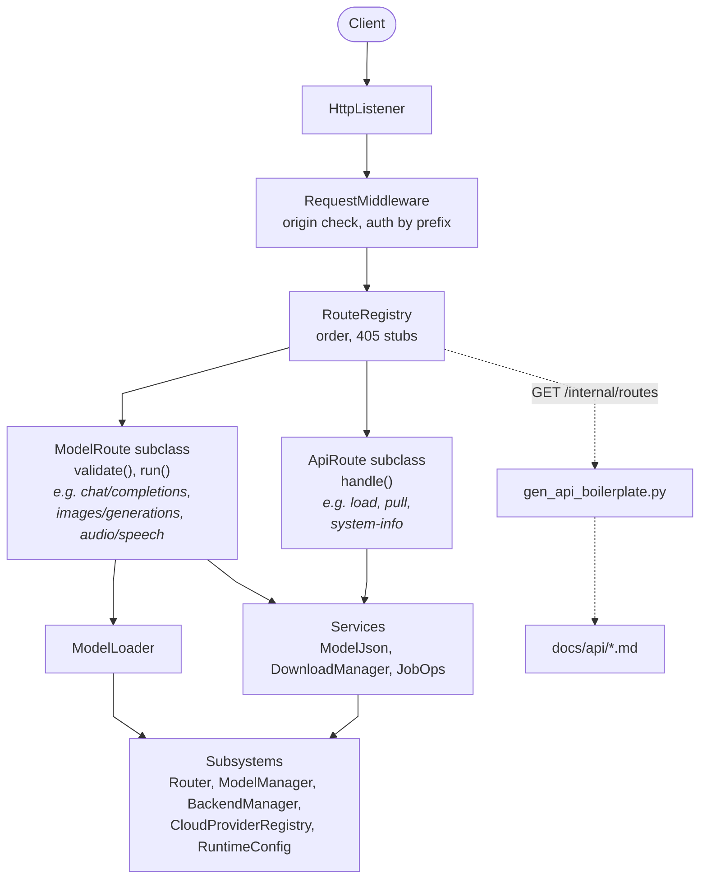

# HTTP Server Spec

- [Summary](#summary)
- [Scope](#scope)
- [Architecture](#architecture)
- [Route Base Classes](#route-base-classes)
- [Route Folders](#route-folders)
- [Core Components](#core-components)
- [Generated Docs](#generated-docs)
- [Appendix A: PR History](#appendix-a-pr-history)
- [Appendix B: Error Format Cleanup](#appendix-b-error-format-cleanup)

## Summary

This spec defines how lemond's HTTP server is organized into route classes, core components and services, and how its API docs are generated from the routes.

The goal is that server PRs are narrowly scoped, easy to author, and easy to review:

- **Narrow.** Changing an endpoint edits one route file. Adding an endpoint adds one file and one registration line in its folder.
- **Easy to author.** Each route's folder matches its docs page, and its docs metadata sits in the same class as its handler.
- **Easy to review.** The base class enforces URL prefixes, auth and 405 handling, and every API change shows up as a diff in the generated docs.

[Appendix A](#appendix-a-pr-history) has the PR history these goals are drawn from.

## Scope

This section lists what the design covers.

- **Routes covered.** Every HTTP route lemond serves, including the Ollama, Anthropic and MCP gateways.
- **Not covered.** The WebSocket APIs (`/realtime`, `/logs/stream`) are not httplib routes, and their docs are hand-written. The MCP tool reference is generated by `gen_mcp_boilerplate.py`.
- **Tests.** End-to-end integration tests cover the routes, and the drift check in [Generated Docs](#generated-docs) covers the docs.

### Compatibility with v2026.42 and Prior

This section lists what lemond keeps so that clients built against v2026.42 and earlier keep working.

- **Public API.** The design preserves the public API: URLs, auth, and request and response bodies. Most status codes and error shapes are preserved; however, improved argument validation can catch errors earlier and return a more accurate code.
- **URL prefixes.** Every endpoint that existed in v2026.42 or earlier is still served under `/api/v0/`, `/api/v1/`, `/v0/` and `/v1/`, through the `Quad` policy in [Prefixes](#prefixes). Only `/v1/` is documented from here on: docs, examples and new client code use `/v1/`, and the [drift check](#drift-check) fails a route whose text names one of the other three.
- **Older names.** Argument aliases, such as `model` for `/delete`'s `model_name`, and path aliases, such as `reranking` and `reranker` for `rerank`, accept the names older clients send. [Argument Validation](#argument-validation) defines how they are read.
- **Empty bodies.** An `OptionalJson` route reads an empty or `null` body as `{}`, because released CLIs send the literal `null` to `POST /unload` when no model is named.
- **Ollama clients.** Ollama's Go client, which the `ollama` CLI uses, always sends both `model` and `name` on `/api/show`, `/api/pull` and `/api/delete` and leaves one empty. The alias rule in [Argument Validation](#argument-validation) drops the empty one, as Ollama's `cmp.Or(model, name)` does. `/api/chat` accepts the `think` values Ollama accepts: a boolean or one of the levels `low`, `medium`, `high` and `max`.

## Architecture

This section shows how a request reaches a route, and how the same routes produce the docs.



`Server` is the composition root: it builds a `ServerContext`, registers every route folder with the `RouteRegistry`, and starts and stops the core components in order. A route writes only its handler; its base class does the shared work, described in [Route Base Classes](#route-base-classes).

## Route Base Classes

This section defines the two base classes every route extends, the `RouteSpec` each route declares, and the helpers routes share.

```cpp
enum class Prefixes { Quad, Internal, Root };      // URLs and auth; see Prefixes below
enum class ArgIn { JsonBody, Query, Path, Form };  // where an argument comes from
enum class RequestFormat { Raw, Json, OptionalJson, Form };  // how the base class parses the request body
enum class ErrorFormat { Plain, OpenAi, Anthropic };          // the body shape of the base class's error responses

// Clients parse each kind of body differently, and some stream.
enum class ResponseFormat {
    Json,          // one JSON body
    JsonLines,     // newline-delimited JSON objects, streamed (application/x-ndjson)
    EventStream,   // server-sent events with JSON data, streamed (text/event-stream)
    Text,          // e.g. Prometheus metrics, markdown, a transcript
    Binary,        // e.g. audio, a glTF mesh
    BinaryStream,  // binary, streamed as generated, e.g. speech
    Empty,         // e.g. the 202 answering an MCP notification
};

// Lemonade honors some arguments only in part, such as images/generations' n, which accepts only 1.
// The docs badge each argument with its level.
enum class Support { Available, Partial, NotAvailable };

struct RouteArg {
    std::string name;
    ArgIn in;
    nlohmann::json schema;            // JSON-schema subset
    bool required = false;
    Support supported = Support::Available;  // Partial: the description states the limit
    std::string description;
    std::vector<std::string> aliases;  // other names clients send it under, e.g. "model" for "model_name"
    bool forwarded = false;            // lemond passes it to the backend without acting on it
};

struct RouteError {
    int status;                       // e.g. 404
    std::string code;                 // the code the body carries, e.g. "model_not_found"; empty when it carries none
    std::string when;                 // the condition, e.g. "`id` names no job"
};

// Each format a route returns gets its own schema in the docs.
struct RouteResponse {
    ResponseFormat format;

    // JSON formats only. JSON Schema for the body, each NDJSON line, or each SSE event's data;
    // --check validates against it. A format with several shapes, such as /load's three, uses oneOf.
    nlohmann::json schema;
};

// Some examples require lemond to be in a certain state, for example unload requires a loaded
// model. A step sends a request that puts lemond in that state before the example runs.
struct ExampleStep {
    std::string route;                // RouteSpec::id
    std::string example;              // that route's RouteExample::name; runs after its own setup
    nlohmann::json args;              // set instead of example: a request sent as is and left out of the docs
};

// gen_api_boilerplate.py sends each example to lemond and records the response into the docs, and
// --check validates the response against the schema of the example's format.
struct RouteExample {
    std::string name;                 // subsection heading, e.g. "streaming" or "save"; required when a route has several
    std::string description;          // what this example shows that the route's other text does not; opens its subsection
    ResponseFormat format;            // the RouteResponse the response is validated against
    nlohmann::json args;              // argument values, e.g. {"id": "$lemonade.jobs_create/id"}
    std::vector<ExampleStep> setup;   // run first, in order
};

struct RouteSpec {
    std::string id;                   // "<page>.<name>", e.g. "openai.chat_completions"; docs anchor
    std::vector<std::string> methods; // e.g. {"POST"}
    std::vector<std::string> paths;   // without prefix; extra entries are aliases, e.g. rerank, reranking
    Prefixes prefixes = Prefixes::Quad;
    std::string summary;              // one line in the page's summary table
    std::string description;          // reference text for the route's docs section
    std::vector<std::string> notes;
    bool experimental = false;        // its contract may still change, so the docs badge it experimental
    std::vector<RouteArg> args;       // every argument
    std::vector<RouteResponse> responses;  // one per format; empty for an unsupported route, e.g. Ollama's POST /api/create (501)
    std::vector<RouteExample> examples;    // the first is the route's main example
    std::vector<RouteError> errors;        // every error response, including those its base class writes
    ErrorFormat error_format = ErrorFormat::Plain;
    RequestFormat request_format = RequestFormat::Raw;  // Raw: no parsing or argument checks; OptionalJson: an empty or null body is {}
    bool quiet_log = false;           // leave out of the access log
};

class ApiRoute {
public:
    explicit ApiRoute(ServerContext& ctx) : ctx_(ctx) {}
    virtual ~ApiRoute() = default;
    virtual RouteSpec spec() const = 0;
    virtual void handle(RouteRequest& req, httplib::Response& res) = 0;
protected:
    ServerContext& ctx_;
};

class ModelRoute : public ApiRoute {
public:
    using ApiRoute::ApiRoute;
    void handle(RouteRequest& req, httplib::Response& res) final;  // resolve, validate, load, run
protected:
    virtual const RouteArg& model_arg() const = 0;  // the argument that names the model
    virtual bool validate(RouteRequest& req, httplib::Response& res) { return true; }
    virtual void run(RouteRequest& req, httplib::Response& res) = 0;
};
```

### Prefixes

The prefix policy sets a route's URLs and the key its requests need, enforced in `Server::authenticate_request()`:

| Policy | URLs | Auth |
| --- | --- | --- |
| `Quad` | `/api/v0/`, `/api/v1/`, `/v0/` and `/v1/` plus each path; only `/v1/` is documented (see [Compatibility](#compatibility-with-v202642-and-prior)). A POST-only path also gets a GET route that answers 405 | `LEMONADE_API_KEY` |
| `Internal` | `/internal/` plus each path | `LEMONADE_ADMIN_API_KEY` |
| `Root` | Each path as written, such as `/live`, `/metrics`, `/mcp` and Ollama's `/api/*` | By path: `/metrics`, `/mcp` and `/api/*` need `LEMONADE_API_KEY`; `/live` needs none |

### Argument Validation

This section defines how `ApiRoute::serve()` checks a request against the route's `RouteArg`s before it calls `handle()`, so a handler never receives a value its schema does not allow.

- **Checks.** For a `Json` or `OptionalJson` route, `serve()` checks every `JsonBody` and `Query` argument, and for a `Form` route, `ModelRoute` checks every `Form` argument once it has built `req.body`. A `required` argument or file must be present, and a value must match its schema's `type`, `enum`, `const`, `minimum`, `maximum`, `minLength`, `maxLength` and `pattern`, as must each value nested in it under `items`, `properties` or `additionalProperties`. A `null` counts as absent, and `serve()` removes it unless the schema's `type` includes `null`. `integer` accepts an integral number such as `2048.0`, and keys that no `RouteArg` declares are ignored. A body that is not a JSON object fails as `kBodyNotJson`. `Raw` routes, such as MCP's JSON-RPC endpoint, are not checked.
- **Aliases.** A client may send an argument under any of its `aliases`. An empty string is not a value when another spelling has one, and `serve()` removes it. `serve()` renames an alias to the argument's name, so a handler reads only the name, and the name wins when a request sends both. The docs list the aliases beside the name.
- **Forwarded arguments.** lemond passes some arguments to the backend without acting on them, such as chat/completions' `temperature`. These are marked `forwarded` and are not checked, since the backend decides what it accepts.
- **Reading arguments.** Each argument is a `RouteArg` constant beside its handler, and `spec()` lists it. Route code names an argument only through its constant: `req.has()`, `req.arg()` and `req.value()` read it, `req.file()` reads an uploaded file, and `req.body[kStream.name]` changes a value the route forwards. A `Query` or `Path` value is converted to its schema's type. A shared helper receives the values of the arguments it needs, not the request. A helper that uses the whole body, such as one that forwards it to a backend or saves it as a model definition, receives the body. An argument that several routes take alike is one constant in `shared_args.h` that they all list, such as `generation::kTemperature`. Routes take an argument alike when everything about it matches except how its description is worded, and they treat it the same way. When routes treat such an argument differently, such as Anthropic's `messages`, which lemond converts to OpenAI's, and chat/completions' `messages`, which it forwards, each route keeps its own constant, and the generator's `DISTINCT_ARGUMENTS` lists the group with how the routes differ. A route that builds another route's request, as the gateways do, names that route's arguments through its constants.
- **Error responses.** The three failures are `ApiRoute::kBodyNotJson`, `kArgMissing` and `kArgInvalid`. Their codes are `invalid_json`, `missing_argument` and `invalid_argument`, and they are written in the route's `error_format`:

| `ErrorFormat` | Body |
| --- | --- |
| `Plain` | `{"error": "message", "code": "missing_argument"}` |
| `OpenAi` | `{"error": {"message", "type": "invalid_request_error", "code"}}` |
| `Anthropic` | `{"type": "error", "error": {"type": "invalid_request_error", "message", "code"}}` |

```cpp
const RouteArg kModelName{"model_name", ArgIn::JsonBody, {{"type", "string"}}, true, Support::Available,
                          "The model to delete.", {"model"}};
const RouteArg kTemperature{"temperature", ArgIn::JsonBody, {{"type", "number"}}, false, Support::Available,
                            "Sampling temperature.", {}, true};

s.args = {kModelName};                                     // in spec()
const std::string model_name = req.value(kModelName, "");  // in handle()
```

### `ModelRoute`

`ModelRoute` is the base for routes that run a loaded model: chat/completions, images/generations, etc. Its `handle()` is final and runs these steps:

1. Builds `req.body`. For a `RequestFormat::Form` route, it copies each `ArgIn::Form` text field into `req.body`, converted to the arg's schema type, answers 400 when the request is not `multipart/form-data`, and checks the arguments as [Argument Validation](#argument-validation) describes. File parts stay on the httplib request. Registration rejects a `ModelRoute` whose `request_format` is `Raw`, since step 2 reads the model from `req.body`.
2. Resolves the model name. It reads the argument `model_arg()` names and passes the value through `canonical_model_name()`.
3. Calls `validate()`. Returning false means `validate()` already wrote the response.
4. Requires a model. With no `model` in the request, it answers 400.
5. Auto-loads the model through `ModelLoader`, unless `validate()` set `req.model_already_loaded` because it picked a model that is already loaded; loading it again would demote a routing helper to a standard model. On failure it writes the `create_model_error` response, the same shape for every model route.
6. Calls `run()`.

`validate()` runs before any load, so it can reject a bad request without loading a model (speech's model-type check, 3D's image check), attach uploaded files in the shape its backend expects (transcription's raw `file`, images/edits' base64 `image` and `mask`), fill in a missing model (classify picks the single loaded classifier), rewrite the model (router collections), or answer the request itself (Omni collections, which load their own components).

Every other route extends `ApiRoute` directly, including `images/upscale`, which runs its upscaler as a one-shot CLI through `IUpscaleServer::upscale_via_cli()` and never loads it.

### Request and Context

`RouteRequest` holds one request's data: the httplib request, the parsed request body unless `request_format` is `Raw`, the `Query` and `Path` arguments, the resolved model name, and the router decision when there is one. Its `has()`, `arg()`, `value()` and `file()` read an argument through its constant, as [Argument Validation](#argument-validation) describes.

`ServerContext` holds pointers to the subsystems (`Router`, `ModelManager`, `BackendManager`, `CloudProviderRegistry`, `AliasManager`, `RuntimeConfig`), to `HttpListener`, and to the services in [Core Components](#core-components). It holds no state of its own. Everything it points to lives as long as lemond, so it has no `WebSocketServer` pointer: a `host` or `websocket_port` change replaces that server, and `/health` reads its port from `HttpListener::websocket_port()`.

Route objects are built once at startup and serve concurrent requests, so they hold no per-request state (Invariant #7).

### Shared Helpers

Routes call these helpers from their own code, so the flow stays visible in the route file:

| Helper | Purpose |
| --- | --- |
| `ApiRoute::stream_response()` | The only way a route streams. Wraps httplib's chunked content provider, sets the SSE headers, and carries the cancel token and telemetry span into the stream, since they must outlive `handle()` |
| `cancel_on_disconnect()` | Aborts the upstream backend request when the client disconnects during a non-streaming request (Invariant #10) |
| `router_dispatch()` | Runs `collection.router` policies and returns the decision; lives in `routes/router/` |
| `attach_route_decision()` | Adds the router decision to the response body and headers |
| `record_usage()` | Records token usage and timings for telemetry |
| `set_error_response()` | Maps a backend error body to its HTTP status, or to the given `RouteError`'s status when the body has none |
| `canonical_model_name()` | Returns the name the registry knows for a model name a client sent, after stripping a `:latest` tag, unless the tagged name is itself a registered model or alias, and following model aliases |

### Response Schemas

This section defines where the schemas in `RouteResponse` come from:

- **In the route class.** Response schemas are JSON Schema, written next to the route's `RouteArg` schemas, so a route's whole contract sits beside its handler. `gen_api_boilerplate.py` reads them from `GET /internal/routes` with the rest of the `RouteSpec`.
- **Shared shapes.** A shape that more than one route returns has a schema function declared beside the function that builds it, such as `ModelJson::schema()` beside `ModelJson::to_json()`, so the shape and its schema change together.
- **Pass-through routes.** The schema describes the public contract the route follows, such as OpenAI's chat completion object, limited to the fields Lemonade returns.

The routing decision is the exception to shared shapes: the routing engine owns its contract in `decision.schema.json`, and lemond does not read that file. A route that returns the decision describes it with a short inline object whose description links to the router page, and the router page links to `decision.schema.json` for the full shape:

```cpp
schema["properties"]["x_lemonade_route"] = {
    {"type", "object"},
    {"description",
     "The routing decision, when `model` names a `collection.router` model. See "
     "[Routing](./router.md#routing-collectionrouter) for the decision object."},
};
```

### Errors

This section defines how a route declares the error responses it can answer with, such as a 404 for an unknown job id. Each is a `RouteError`: its HTTP status, the `code` its body carries, and when it is returned. The route's handler writes some of a route's error responses, and its base class and shared helpers write the rest, so `RouteSpec::errors` lists them from these places:

- **In the route class.** Each error response a route writes is a `RouteError` constant beside its handler. The handler passes it to an error writer such as `write_plain_error()`, which takes the status and code from it, and `spec()` lists it.
- **Shared error responses.** An error response that more than one route writes is declared beside the function that writes it, such as `ModelLoader::errors()` beside `ModelLoader::write_load_error()`.
- **Base classes.** A base class declares the error responses its own steps write, such as `ApiRoute::kArgMissing` for a missing required argument, and a route lists the ones its base class writes for it. A route that overrides `write_exception()` lists what its override writes instead.
- **Backend errors.** A route that passes a backend's error through lists `kBackendError`, and also the backend error responses a client can act on, such as llama.cpp's 501 for a model that cannot embed.

An error in a response that has already started, such as an error event in a stream, is a shape of the route's `RouteResponse::schema`.

```cpp
const RouteError kUnknownJob{404, "", "`id` names no job"};

s.errors = {kUnknownJob};                            // in spec()
write_plain_error(res, kUnknownJob, "unknown job");  // in handle()
```

### Complete Example

`routes/openai/text/chat_completions.cpp`:

```cpp
nlohmann::json chat_completion_schema() {
    auto schema = nlohmann::json::parse(R"({
        "type": "object",
        "required": ["id", "object", "created", "model", "choices", "usage"],
        "properties": {
            "id": {"type": "string"},
            "object": {"const": "chat.completion"},
            "created": {"type": "integer"},
            "model": {"type": "string"},
            "choices": {"type": "array", "items": {
                "type": "object",
                "required": ["index", "message", "finish_reason"],
                "properties": {
                    "index": {"type": "integer"},
                    "message": {
                        "type": "object",
                        "required": ["role", "content"],
                        "properties": {
                            "role": {"const": "assistant"},
                            "content": {"type": ["string", "null"]}
                        }
                    },
                    "finish_reason": {"type": "string"}
                }
            }},
            "usage": {
                "type": "object",
                "required": ["prompt_tokens", "completion_tokens", "total_tokens"],
                "properties": {
                    "prompt_tokens": {"type": "integer"},
                    "completion_tokens": {"type": "integer"},
                    "total_tokens": {"type": "integer"}
                }
            }
        }
    })");
    // Router collections add their routing decision to the response.
    schema["properties"]["x_lemonade_route"] = {
        {"type", "object"},
        {"description",
         "The routing decision, when `model` names a `collection.router` model. See "
         "[Routing](./router.md#routing-collectionrouter) for the decision object."},
    };
    return schema;
}

nlohmann::json chat_completion_chunk_schema() {
    return nlohmann::json::parse(R"({
        "type": "object",
        "required": ["id", "object", "created", "model", "choices"],
        "properties": {
            "id": {"type": "string"},
            "object": {"const": "chat.completion.chunk"},
            "created": {"type": "integer"},
            "model": {"type": "string"},
            "choices": {"type": "array", "items": {
                "type": "object",
                "required": ["index", "delta", "finish_reason"],
                "properties": {
                    "index": {"type": "integer"},
                    "delta": {
                        "type": "object",
                        "properties": {
                            "role": {"const": "assistant"},
                            "content": {"type": ["string", "null"]}
                        }
                    },
                    "finish_reason": {"type": ["string", "null"]}
                }
            }}
        }
    })");
}

const RouteArg kModel{"model", ArgIn::JsonBody, {{"type", "string"}}, true, Support::Available,
                      "Model to run; loaded on first use."};
const RouteArg kMessages{"messages", ArgIn::JsonBody, {{"type", "array"}}, true, Support::Available,
                         "Conversation in OpenAI format."};
const RouteArg kLogprobs{"logprobs", ArgIn::JsonBody, {{"type", "boolean"}}, false, Support::NotAvailable,
                         "Return the log probability of each output token.", {}, true};

class ChatCompletionsRoute : public ModelRoute {
public:
    using ModelRoute::ModelRoute;

    RouteSpec spec() const override {
        RouteSpec s;
        s.id = "openai.chat_completions";
        s.methods = {"POST"};
        s.paths = {"chat/completions"};
        s.prefixes = Prefixes::Quad;
        s.summary = "Chat Completions";
        s.description = "Generates the next assistant message for a conversation.";
        s.args = {kModel, kMessages, common::kStream, kLogprobs};

        s.responses = {
            {ResponseFormat::Json, chat_completion_schema()},
            {ResponseFormat::EventStream, chat_completion_chunk_schema()},
        };

        RouteExample completion;
        completion.name = "non-streaming";
        completion.format = ResponseFormat::Json;
        completion.args = nlohmann::json::parse(R"({
            "model": "Qwen3-0.6B-GGUF",
            "messages": [{"role": "user", "content": "What is the capital of France?"}]
        })");

        RouteExample stream;
        stream.name = "streaming";
        stream.format = ResponseFormat::EventStream;
        stream.args = nlohmann::json::parse(R"({
            "model": "Qwen3-0.6B-GGUF",
            "messages": [{"role": "user", "content": "What is the capital of France?"}],
            "stream": true
        })");

        s.examples = {completion, stream};
        s.errors = join_errors({{kBodyNotJson, kArgMissing, kArgInvalid, kBackendError, kUnexpectedException},
                                ModelLoader::errors()});
        s.error_format = ErrorFormat::OpenAi;
        s.request_format = RequestFormat::Json;
        return s;
    }

protected:
    const RouteArg& model_arg() const override { return kModel; }

    bool validate(RouteRequest& req, httplib::Response& res) override {
        if (is_omni_collection(ctx_, req.model)) {
            run_omni_collection(ctx_, req, res);
            return false;
        }
        req.route_decision = router_dispatch(ctx_, req);
        return true;
    }

    void run(RouteRequest& req, httplib::Response& res) override {
        if (req.value(common::kStream, false)) {
            stream_response(req, res, [this](const std::string& body, httplib::DataSink& sink) {
                ctx_.router->chat_completion_stream(body, sink);
            });
            return;
        }
        auto cancel = cancel_on_disconnect(req);
        nlohmann::json response = ctx_.router->chat_completion(req.body);
        if (response.contains("error")) {
            set_error_response(response, res, kBackendError);
            return;
        }
        attach_route_decision(response, res, req.route_decision);
        record_usage(response, req);
        res.set_content(response.dump(), "application/json");
    }
};

std::unique_ptr<ApiRoute> make_chat_completions_route(ServerContext& ctx) {
    return std::make_unique<ChatCompletionsRoute>(ctx);
}
```

The folder's `routes/openai/text/routes.cpp` registers it with one line: `registry.add(make_chat_completions_route(ctx));`.

## Route Folders

This section lays out where each route lives. Each top-level folder under `routes/` is one `docs/api` page, and each subfolder is a section of that page.

```text
src/cpp/server/
  server.cpp          Server: builds ServerContext, registers folders, starts and stops core
  core/               HttpListener, RequestMiddleware, RouteRegistry, ApiRoute, ModelRoute,
                      ConfigEffects, WebUi
  services/           ModelLoader, ModelJson, DownloadManager, JobOps, audio format negotiation,
                      gateway stream conversion, Omni collection orchestration
  routes/
    openai/           docs/api/openai.md
      text/           chat/completions, completions, responses, embeddings
      images/         images/generations, images/edits, images/variations, images/upscale
      audio/          audio/transcriptions, audio/speech
      models/         models, models/{id}, and the Lemonade extensions
                      models/{id}/files and models/{id}/options
    lemonade/         docs/api/lemonade.md
      models/         models/register, pull, pull/variants, registry/search, delete,
                      models/check-updates
      downloads/      downloads, downloads/control
      load/           load, unload
      inference/      classify, audio/generations, 3d/generations
      backends/       install, install/dry-run, uninstall, cloud/auth
      system/         health, live, stats, system-stats, system-info, metrics, docs
      jobs/           jobs and its sub-routes
    llamacpp/         docs/api/llamacpp.md: rerank, slots, tokenize
    router/           docs/api/router.md: routing/validate, router_dispatch()
    internal/         docs/api/internal.md: shutdown, telemetry/flush, pin, set, config,
                      config/defaults, cleanup-cache, simulate-vram-pressure, models/sync,
                      models/sync/status, aliases, routes
    ollama/           docs/api/ollama.md
    anthropic/        docs/api/anthropic.md
    mcp/              docs/api/mcp.md
```

Registration follows these rules:

- **One file per route.** A route is one `.cpp` file that defines its class and a `make_<name>_route()` factory. Headers for core components and services go in `src/cpp/include/lemon/server/`; route classes have no header. The arguments of the OpenAI routes, whose requests the gateways build, are declared in `openai_args.h` there and defined in `routes/openai/`. Arguments that several routes take alike are declared in `shared_args.h` there and defined in `routes/shared_args.cpp`.
- **One list per folder.** Each folder's `routes.cpp` declares its factories and adds them to the `RouteRegistry` in registration order. `Server` calls each folder's registration function. CMake collects `routes/` sources with `file(GLOB_RECURSE ... CONFIGURE_DEPENDS)`, as it does for `docs/api`, so adding a route edits no CMake file.
- **Order.** httplib uses the first registered route that matches, so routes register in the order each folder's `routes.cpp` lists them, and a folder lists a specific path before a pattern that also matches it, such as `models/{id}/files` before `models/{id}`. `WebUi` registers its catch-all route after every API route.
- **Path parameters.** Each `{name}` in a path becomes a capture group that matches its `Path` argument's `pattern`, digits for an `integer`, or one path segment otherwise. `RouteRequest` reads path parameters by group number, so registration rejects a route whose paths name different parameters or name them in a different order, and a `pattern` that has a group of its own.
- **Gateways.** The Anthropic routes live in `routes/anthropic/`, separate from Ollama's. The OpenAI-to-gateway stream conversion both use lives in `services/`. `McpServer`'s HTTP route is a route class in `routes/mcp/`.

## Core Components

This section lists the core components, each with an interface of a few calls:

| Class | Interface | Responsibilities |
| --- | --- | --- |
| `HttpListener` | `start()`, `stop()`, `rebind()`, `websocket_port()` | Thread pools, IPv4 and IPv6 bind loop, UDP beacon, the `WebSocketServer` and its restart, rebind on host or port change |
| `RequestMiddleware` | One pre-routing function | Origin check and CORS, API and admin keys, per-request telemetry and session context |
| `RouteRegistry` | `add()`, `apply(httplib::Server&)`, `list()` | Prefix expansion, 405 stubs, registration order, the route list for the docs |
| `ConfigEffects` | `apply(key)`, called at startup and on every config change | Applies each config key's side effects, at startup and on change |
| `WebUi` | `register_routes(httplib::Server&)`, called last | The SPA, the legacy status page, static assets and the SPA fallback |
| `ModelLoader` | `ensure_loaded()`, `write_load_error()`, `errors()` | Auto-load, collection loading, load errors. Used by `ModelRoute` and the gateways |
| `ModelJson` | `to_json(id, info)`, `schema()` | Builds the model JSON for the models routes, the status page and the job engine |
| `DownloadManager` | `start()`, `list()`, `control()`, `cancel_all()`, `stream()`, `job_schema()`, `event_schema()` | Server-owned download jobs and their threads, and the download event stream that pull and install send |
| `JobOps` | `build(ServerContext&)` | Builds the job engine's op providers |

These are internal details of other classes:

- `resolve_host_to_ip()` and `parse_traceparent()` are private to `HttpListener` and `RequestMiddleware`.
- `/internal/shutdown` is an ordinary route in `routes/internal/` that calls `Server::stop()`.

## Generated Docs

This section specifies how `docs/api` is generated from the routes, including real request and response examples.

### Generator

`docs/tools/gen_api_boilerplate.py` follows `gen_mcp_boilerplate.py`: it starts lemond through the `Lemond` harness in `gen_backend_boilerplate.py` and rewrites only BEGIN/END GENERATED regions. It runs these steps:

1. Reads every `RouteSpec` from `GET /internal/routes`, a route class in `routes/internal/`.
2. For each page (a top-level folder), writes the summary table at the top of the page.
3. For each route, writes a region in the API reference layout of the documentation guide: the method and path heading, a status badge, the description, the route's other paths and its auth, a Parameters table with each argument's `Support` badge (`available`, `partial` or `not_available`), the notes, the Examples and Response format sections described in [Examples](#examples), and an Errors table listing each of the route's `errors` by status, code and `when`. The route's badge is the first that applies: `experimental` when the route sets `experimental`, `not_available` when `responses` is empty, `fully_available` when every argument is `Support::Available`, and `partially_available` otherwise.
4. Fills the Examples section from the response cache, running each example's setup and request against lemond only when its cache entry is invalid.

Page intros and concept sections stay hand-written between the regions, such as routing policies, VAD configuration, model labels, and the WebSocket APIs.

### Examples

The Examples section gives each of the route's `examples` its own subsection, headed by its `name`, such as "Streaming". The subsection opens with the example's `description`, then has PowerShell and Bash tabs for the request and shows what lemond returned. A route with one example has a single Example section with no subsection. The Response format section then describes each format once, under a heading per format when the route has several. It opens with the top-level `description` of the format's `RouteResponse::schema`, then lists each property's `description`, with nested properties indented under their parent. A format with several shapes gives each shape a heading from its `title`, such as "Error event", then that shape's `description` and properties. A schema shared between routes, such as the routing decision, is listed in full wherever it appears. The generator builds and records examples by these rules:

- **Arguments.** An example's `args` maps argument names to values, and each value goes where its `RouteArg::in` says: the path, the query string, the JSON body or the multipart form.
- **Files.** A `@fixtures/<file>` marker is read from `docs/tools/fixtures/`. It is a whole value, or follows a prefix such as `data:image/png;base64,`. A JSON body argument shows it in curl as `$(base64 -w0 <file>)`, and a form argument as `-F <name>=@<file>`.
- **Setup.** The steps in `setup` run first, in order. A step that names an example runs it after that example's own setup; a step with `args` sends that request as is and is left out of the docs. A `$<route id>/<json pointer>` value takes that field from the most recent response the route returned.
- **One lemond.** Every example runs against one lemond started by the `Lemond` harness, which starts it again after an example stops it, as `/internal/shutdown` does. An example that deletes or uninstalls something removes what its own setup added.
- **Recorded output.** Every response opens with its status and reason phrase on its Response label, such as `200 OK`, followed by a JSON body, the first three and last two events or lines of a stream, the first 20 lines of a `Text` body, or the `Content-Type` and byte count of a `Binary` or `BinaryStream` body.
- **Long values.** A string longer than 1,000 characters in a JSON body, NDJSON line or SSE event, such as a base64 image, is recorded as its first 80 characters and its length. In the page, a JSON array of more than 16 numbers or strings that does not fit on one line, such as an embedding, shows its first 8 items and how many more there are. A JSON array of objects, or an object whose keys are data rather than field names (a schema with `additionalProperties`), such as search results or system-info's recipes, shows its first entry and how many more there are.
- **Paths.** Recorded responses show the harness's temporary cache directory as lemond's default, `~/.cache/lemonade`, and the recording machine's home directory as `~`.

### Route Documentation Contract

This section specifies what each route's text says. The generator prints each route's heading, status badge, URL, aliases, auth requirement, Parameters table and recorded examples, so no text field restates them. A `Quad` route is documented only at its `/v1/` URL; the other prefixes stay undocumented and serve existing clients.

| Field | States | Never states |
| --- | --- | --- |
| `summary` | What the route does, as a verb phrase of at most 10 words, such as "Pause a job" | Support status, formats, the description |
| `description` | What the route does, and who uses it when that is not obvious, in at most 3 sentences, third person present ("Loads a model...") | URLs, prefixes, aliases, auth, argument details or defaults, the page intro |
| `notes` | Behavior no argument, field or error can carry: side effects, interactions between arguments, or a concept that belongs to this route alone, under a `###` heading. One topic per note | The description, another note, a parameter row, a field description, a request or response, which belongs in `examples` |
| `RouteArg::description` | What the argument controls, its accepted values, its default ("Defaults to `false`."), and when it is required if that depends on other arguments | Where the argument goes, the Required column, the route's behavior |
| Top-level `description` of a `RouteResponse::schema`, or of one of its shapes | What the response is as a whole: how a stream's lines or events relate, such as which line ends it, or when this shape is returned | A field's meaning |
| `title` of a shape | A short name for the shape, such as "Chunk" or "Error event" | The format, when the shape is returned |
| Property `description` in a `RouteResponse::schema` | What the field means, and when it is present if it is not always | Its type, the route's behavior |
| `RouteError::when` | The condition that produces the error, as a clause such as "`id` names no job". For an error passed through from a backend, also that the backend's status replaces this one | The status, the code, the body's message |
| `RouteExample::name` | A lowercase label for what differs, such as `streaming` or `save` | Formats the name already implies |
| `RouteExample::description` | What this example shows that the route's other text does not, such as which model or file it uses, or a request shape that only this example uses | The route's general behavior, which belongs in `notes` |

These rules apply across the fields:

1. Each fact appears once in a route's section; other text refers to it.
2. A behavior claim matches the handler code, or a run of the route, before it is written.
3. A URL uses the `/v1/` form, and never `/api/v0/`, `/api/v1/` or `/v0/`.
4. Identifiers, values and placeholders such as `<PROVIDER>` are in backticks.
5. A mention of another route links to its section.

A page intro states what the API family is and the facts true of every route on the page, such as Ollama's error shape, and routes do not repeat them. Routes state only whether they need an API key, so the top-level API reference states how a client sends `LEMONADE_API_KEY` and `LEMONADE_ADMIN_API_KEY`. A page sets the order of its sections: the generator never moves an existing region, inserts a new route's region after the route registered before it, and orders the summary table to match the sections.

### Response Cache

Recorded responses live in `docs/tools/api_examples_cache.json`, one entry per example. An entry's key is the SHA-256 of:

- the route `id` and the example's `format`
- the canonical JSON of its `args` and of every step in its `setup`
- for a pass-through route, its backend's pinned version from `backend_versions.json`

A new example, a changed request, or a backend version bump changes the key and invalidates the entry. A schema change does not, because [Drift Check](#drift-check) validates every entry against the current schemas. Valid entries are never re-run, so examples change only when one of those inputs does. The cache is first warmed on a machine that runs every backend.

A recorded response shows the shape of the route's response. Its values can fall behind what lemond returns today, for example after a model's weights change, and that is fine: Drift Check holds the shape, not the values.

### Drift Check

CI runs `gen_api_boilerplate.py --check` on a hosted runner, beside the other generators, without loading any model. It fails when:

- a route has no region, or a region has no route
- a page that has routes has no entry in the `mkdocs.yml` nav or no row in the page table in `docs/api/README.md`, or either one lists a page under `docs/api/` that has no routes, other than `README.md` itself
- any generated text is stale
- any cache entry is invalid
- a recorded response does not match its entry's format, or a JSON body, NDJSON line or SSE event's data does not match its schema, validated with `jsonschema` (OpenAI's closing `[DONE]` event is skipped)
- a JSON format has no `schema`, or another format has one, or a shape in a `oneOf` has no `title`
- a file under `routes/` or `services/` assigns a literal error status to `res.status` or passes one to an error writer, or a route file uses a `RouteError` that its route's `errors` does not list, or leaves out one its base class writes for it or lists one its base class never writes for it
- a route file declares an argument in `args` instead of as a `RouteArg` constant, names an argument or one of its aliases by a string literal, such as `req.body["stream"]`, writes another route's request with a string literal key, or uses a `RouteArg` that its route's `args` does not list
- a helper under `routes/` or `services/` that takes a `RouteRequest` names a declared argument by a string literal on it, such as `req.body["model"]`
- two `RouteArg` constants have the same name and aliases, location, schema and flags, whatever their descriptions say, unless the generator's `DISTINCT_ARGUMENTS` lists them with how their routes treat the argument differently, or that list names a group that no longer matches
- a route's `description`, `notes` or argument descriptions name an error status, such as `404`
- a `Raw` route other than MCP's JSON-RPC endpoint reads its request body
- a route's text has an em dash, a placeholder outside backticks, the prefixes `/api/v0/`, `/api/v1/` or `/v0/`, a phrase the generator prints ("Also served at", "Requires `LEMONADE_API_KEY`") or a `> **Note:**` callout; a `summary` runs over 10 words; a `description` runs over 3 sentences; or a sentence of 40 or more characters appears twice in one route's region
- a JSON format, or one of its shapes, has no example whose response it validates, unless the shape sets `x-no-example` to the reason no recording machine can return it
- a field in a recorded JSON response has no `description` in its schema, unless an enclosing field is described without listing its properties
- a recorded JSON body runs over 100 lines in the page
- an example names an argument the route does not have or a format not in `responses`, a route with several examples leaves one unnamed or repeats a name, a `setup` step names a route or example that does not exist, or a `$<route id>` value names a route that did not run during setup

The author fixes it by running the generator locally and committing the result. The weekly backend-bump workflows (`validate_llamacpp.yml`, `validate_sdcpp.yml`, `validate_vllm.yml`) run each new version on self-hosted runners; their runner job also runs the generator for the entries the bump invalidated, and the PR the workflow opens includes the updated cache.

### Claim Review

Drift Check cannot tell whether a sentence is true, so rule 2 of the [Route Documentation Contract](#route-documentation-contract) is enforced by review. When a PR changes a route's text, schemas, examples or handler, the reviewer reads the route's generated section beside its handler and checks:

- each claim in the description, notes, argument descriptions and field descriptions against the code
- each example's name and description against its request
- that behavior a client relies on, such as an error status or a side effect, is stated

A claim that cannot be traced to the code or to a recorded response is fixed or removed before the PR merges.

### Generated Output

The route in [Complete Example](#complete-example) generates this region of openai.md:

````markdown
<!-- BEGIN GENERATED: openai.chat_completions -->
## `POST /v1/chat/completions`
<sub></sub>

Generates the next assistant message for a conversation.

Requires `LEMONADE_API_KEY` when it is set.

### Parameters

| Parameter | Required | Description | Status |
|-----------|----------|-------------|--------|
| `model` | Yes | Model to run; loaded on first use. | <sub></sub> |
| `messages` | Yes | Conversation in OpenAI format. | <sub></sub> |
| `stream` | No | Stream tokens as server-sent events. | <sub></sub> |
| `logprobs` | No | Return the log probability of each output token. | <sub></sub> |

### Examples

#### Non-streaming

=== "PowerShell"

    ```powershell
    Invoke-WebRequest `
      -Uri "http://localhost:13305/v1/chat/completions" `
      -Method POST `
      -Headers @{ "Content-Type" = "application/json" } `
      -Body '{"model": "Qwen3-0.6B-GGUF", "messages": [{"role": "user", "content": "What is the capital of France?"}]}'
    ```

=== "Bash"

    ```bash
    curl http://localhost:13305/v1/chat/completions \
      -H "Content-Type: application/json" \
      -d '{"model": "Qwen3-0.6B-GGUF", "messages": [{"role": "user", "content": "What is the capital of France?"}]}'
    ```

**Response:** `200 OK`

```json
{
  "id": "chatcmpl-a1B2c3D4e5F6",
  "object": "chat.completion",
  "created": 1759766400,
  "model": "Qwen3-0.6B-GGUF",
  "choices": [{"index": 0, "message": {"role": "assistant", "content": "The capital of France is Paris."}, "finish_reason": "stop"}],
  "usage": {"prompt_tokens": 15, "completion_tokens": 8, "total_tokens": 23}
}
```

#### Streaming

=== "PowerShell"

    ```powershell
    Invoke-WebRequest `
      -Uri "http://localhost:13305/v1/chat/completions" `
      -Method POST `
      -Headers @{ "Content-Type" = "application/json" } `
      -Body '{"model": "Qwen3-0.6B-GGUF", "messages": [{"role": "user", "content": "What is the capital of France?"}], "stream": true}'
    ```

=== "Bash"

    ```bash
    curl http://localhost:13305/v1/chat/completions \
      -H "Content-Type: application/json" \
      -d '{"model": "Qwen3-0.6B-GGUF", "messages": [{"role": "user", "content": "What is the capital of France?"}], "stream": true}'
    ```

**Response:** `200 OK`

```text
data: {"id": "chatcmpl-a1B2c3D4e5F6", "object": "chat.completion.chunk", "created": 1759766400, "model": "Qwen3-0.6B-GGUF", "choices": [{"index": 0, "delta": {"role": "assistant", "content": ""}, "finish_reason": null}]}
data: {"id": "chatcmpl-a1B2c3D4e5F6", "object": "chat.completion.chunk", "created": 1759766400, "model": "Qwen3-0.6B-GGUF", "choices": [{"index": 0, "delta": {"content": "The"}, "finish_reason": null}]}
data: {"id": "chatcmpl-a1B2c3D4e5F6", "object": "chat.completion.chunk", "created": 1759766400, "model": "Qwen3-0.6B-GGUF", "choices": [{"index": 0, "delta": {"content": " capital"}, "finish_reason": null}]}
...
data: {"id": "chatcmpl-a1B2c3D4e5F6", "object": "chat.completion.chunk", "created": 1759766400, "model": "Qwen3-0.6B-GGUF", "choices": [{"index": 0, "delta": {}, "finish_reason": "stop"}]}
data: [DONE]
```

### Response format

- `x_lemonade_route` - The routing decision, when `model` names a `collection.router` model. See [Routing](./router.md#routing-collectionrouter) for the decision object.

### Errors

| Status | Code | When |
|--------|------|------|
| `400` | `invalid_json` | The body is not a JSON object |
| `400` | `missing_argument` | A required argument is missing |
| `400` | `invalid_argument` | An argument or a value nested in it has the wrong JSON type, or a value its schema does not list |
| `404` | `model_not_supported` | The requested model is filtered out on this system, such as an NPU model without an NPU |
| `404` | `model_not_found` | The requested model is not in the registry |
| `409` | `router_residency_conflict` | Loading the requested model would evict a model that a `collection.router` model needs resident on the same NPU |
| `409` | `slots_pinned_error` | Every loaded model of the requested model's type is pinned, so none can be unloaded to make room |
| `500` |  | The backend reports an error; the backend's own status replaces this one when it sends one |
| `500` | `model_load_error` | Loading the requested model fails for another reason, such as a failed download or a backend that does not start |
| `500` |  | The request fails unexpectedly |
<!-- END GENERATED: openai.chat_completions -->
````

## Appendix A: PR History

This appendix holds the PR data behind the design: all 225 PRs that edited server.cpp from Oct 30, 2025 to Sep 28, 2026, minus 12 mechanical sweeps such as reformatting, plus the 45 open PRs that edit it as of Oct 5, 2026.

Each kind of PR, with its share of the last 6 months (133 PRs), what it edited in the single-file server, and where it lands under this spec:

| Kind of PR | Share | Edited in the single-file server | Lands in |
| --- | --- | --- | --- |
| Change one endpoint | 35% | One handler; 29% also a shared helper | One route file |
| Add an endpoint | 15% | Handler, route table (100%), `server.h` (97%) | One new route file, one line in its folder's `routes.cpp` |
| Config key with a runtime effect | 9% | Constructor (60%), config switch (55%), `server.h` (50%) | `ConfigEffects` |
| Same change across many handlers | 8% | 3 or more handlers | `ModelRoute`, `ModelLoader` or one shared helper |
| New subsystem | 8% | Constructor, route table, `server.h`, includes | A new route folder or service, plus one line in `Server` |
| Middleware | 8% | Pre-routing lambda or `authenticate_request()` | `RequestMiddleware` |
| Model JSON field | 6% | `model_info_to_json()`, often a second copy | `ModelJson` |
| Listener and process lifecycle | 5% | `run()`, `stop()` | `HttpListener` |
| Remove an endpoint | 4% | Handler, route table, `server.h` | One route file and its registration line |
| Web UI serving | 2% | `setup_static_files()` | `WebUi` |

Findings that shaped specific rules:

- Across all PRs, 37% edited `server.h` and 24% the include block, the two spots unrelated PRs most often both edit. Route classes have no headers.
- Replayed against the folder layout, 14 of the 19 PRs that would have touched 3 or more route folders were changing model loading, load errors, router dispatch or telemetry. These have one home in `ModelRoute` or a shared helper.
- 9 of the open PRs edit collections and routing. Hence the `router/` folder.

## Appendix B: Error Format Cleanup

This appendix describes a change that unifies error shapes, which vary by route: some return `{"error": "message"}`, some an OpenAI-style object, and invalid JSON gets a 400 from `chat/completions` but a 500 from `completions`.

Each route folder adopts the error format of the API its page documents:

| Route folder | Error format |
| --- | --- |
| `openai/` | `{"error": {"message", "type", "code"}}` |
| `anthropic/` | `{"type": "error", "error": {"type", "message"}}` |
| `ollama/` | `{"error": "message"}` |
| `lemonade/`, `internal/`, `router/`, `llamacpp/` | `{"error": {"message", "type", "code"}}` |

Each route's `error_format` follows its folder, each route writes its `RouteError`s in that format, and pull's and install's streams send their `error` events in the same shape. The `write_exception()` overrides and their error lists are removed. The same PR updates the clients that read `error` as a string, each a one-line change to accept either shape:

- **CLI:** `src/cpp/cli/main.cpp:1164` reads `/internal/set`'s error, and `src/cpp/cli/lemonade_client.cpp:1037`, `1082` and `1423` read the `error` events of pull's and install's streams. Line 1423 calls `get<std::string>()` without a type check and would throw.
- **GUI:** `src/app/src/renderer/utils/backendInstaller.ts:14` handles only strings, and `src/app/src/renderer/components/RouterTestPromptPanel.tsx:194` renders `data?.error` directly.

Older CLIs and GUIs connected to a newer server would still hit those cases, which is why this change ships on its own.
