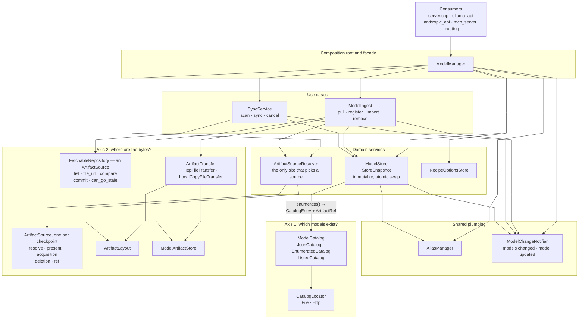

# Model Management Spec

- [Summary](#summary)
- [Scope](#scope)
- [Routing Boundary](#routing-boundary)
- [Architecture](#architecture)
- [ModelManager Facade](#modelmanager-facade)
- [Model Catalogs](#model-catalogs)
- [Catalog Locators](#catalog-locators)
- [Model Store](#model-store)
- [Hardware Filtering](#hardware-filtering)
- [Name Resolution](#name-resolution)
- [Identity: Handles And Provenance](#identity-handles-and-provenance)
- [Two Kinds Of Staleness](#two-kinds-of-staleness)
- [Artifact Sources](#artifact-sources)
- [Fetchable Repositories](#fetchable-repositories)
- [Transfer And Layout](#transfer-and-layout)
- [Local Artifact Store](#local-artifact-store)
- [Ingest And Registration](#ingest-and-registration)
- [Sync](#sync)
- [Change Notification](#change-notification)
- [Recipe Options](#recipe-options)
- [Concurrency](#concurrency)
- [Source Layout](#source-layout)
- [Contracts](#contracts)
- [Generated Docs](#generated-docs)
- [Tests](#tests)

## Summary

This spec defines how lemond answers three questions: which models exist, what a model name refers to, and where a model's bytes are. It covers catalogs, the model store, name resolution, artifact sources and repositories, transfer, ingest, sync, change notification, recipe options, and the `ModelManager` that composes them and faces the HTTP layer.

The three goals that decide every design choice here:

- **Two axes.** *Which models exist* and *where the bytes come from* are separate questions with separate interfaces, joined by one value, the `ArtifactRef`. Every component sits on one axis or the other.
- **Extension is local.** A new catalog, artifact repository, or download source is one `.cpp` file, one build line, one registration line, and one descriptor. It documents itself: [Generated Docs](#generated-docs) fails CI when a registered source has no docs.
- **Clear separation of concerns.** One function resolves a name, one site binds a checkpoint to a source, one component publishes the model set, one counter announces a new set. A caller never re-derives an answer, and no component branches on another's identity to get one.

## Scope

This section lists what the design covers.

- **Components covered.** Catalogs and their locators, the model store and its published snapshot, name resolution and aliases, artifact sources and fetchable repositories, transfer and layout, the local artifact store, ingest, sync, change notification, recipe options persistence, and the `ModelManager` composition root and facade.
- **Documentation.** A catalog or repository documents itself through a descriptor, and CI fails when one is missing; see [Generated Docs](#generated-docs).
- **Contracts held.** The on-disk files, the API fields clients read, and the cache layout keep the meanings stated in [Contracts](#contracts).
- **Not covered: routing.** See [Routing Boundary](#routing-boundary).
- **Tests.** See [Tests](#tests).

## Routing Boundary

This section states which questions model management answers and which belong to routing.

Model management answers what *can* run: the set of models, why one cannot run now, and the helper models the policies in force require. Routing answers what *does* run: policy parsing and evaluation, candidate scoring, load and unload decisions, residency, session affinity, and the runtime that holds loaded models.

| Question | Answered by | Where the answer lives |
| --- | --- | --- |
| Which models exist, and which of them can this machine run now | model management | [`ModelStore`](#model-store), [`filter_hardware()`](#hardware-filtering) |
| Why a model cannot run now | model management | `StoreSnapshot::rejected` |
| Which helper models the policies in force require | model management | `StoreSnapshot::helper_models`, projected during a store build |
| That a resident helper set needs reconciling | model management | [Change Notification](#change-notification) |
| The policy a model declares | routing, parsed from the recipe document | `ModelInfo::route_policy`, carried |
| Whether a policy accepts a request, and what to load for it | routing | the policy engine |

1. Routing reads model management through `resolve()`, `model_exists()`, `get_public_model_name()` and `options()`. `options()` carries the architecture-defaults overlay, so routing reads no options file.
2. `ModelStore` carries `ModelInfo::route_policy` without interpreting it. The only part it reads is the helper-name list it projects into the snapshot.
3. No component in this spec evaluates a policy expression or decides which model to load.

## Architecture

This section shows the two axes, the components that sit on each, and the one direction every call goes.



`ModelManager` is the composition root: from one `ModelManagerConfig` it builds, in this order, the change notifier, the alias manager, the recipe-options store, the artifact store, the transfer mechanism, the catalog set, the store, the artifact resolver, the ingest use case and the sync service. `Server` fills in the config — cache directory, config directory, extra-models directory, the installed-backend availability probe, the cloud provider registry — constructs the facade once, and hands it to routes, gateways and routing. A test or an embedder builds the same facade over fixture paths and fixture catalogs, which is the one injection point model management offers.

Catalogs and artifact sources stay separate types because a catalog entry pointing at Qwen on Hugging Face resolves to two different objects: the document that names the model, and the repository hosting its bytes. `ArtifactRef` is the join — the value a catalog emits and a source consumes. For an imported directory one class may implement both interfaces; the types stay split because that is the exception.

## ModelManager Facade

This section defines the single model-facing interface the HTTP layer, the gateways and the router use.

`ModelManager` builds the components and owns none of their logic. It exists so orchestration has one owner instead of a route per feature: every step a route would otherwise write by hand — resolving a name, expanding alias rows for a listing, aggregating checkpoint status, sequencing a pull, projecting helper models — is one facade call.

```cpp
struct ModelManagerConfig {
    std::string cache_dir;                 // empty: whatever utils::get_cache_dir() resolves to
    std::string extra_models_dir;
    CloudProviderRegistry* cloud_providers = nullptr;   // listings for ListedCatalog
    std::function<std::string()> default_model_source;  // registry a bare checkpoint lands on
    std::function<json()> model_catalogs;               // configured catalog documents
    std::vector<std::shared_ptr<ModelCatalog>> extra_catalogs;  // tests and embedders
    // What this machine can run, read at the start of every rebuild; empty probes
    // the hardware. A caller that means a particular machine says so here.
    std::function<BackendAvailability(const std::map<std::string, ModelInfo>&)> availability;
    // The single seam that picks the repository answering for a checkpoint, threaded
    // unchanged into every consumer: pull, update scan, artifact sources and the
    // checkpoint-status read alike. Empty binds the real host.
    std::function<std::unique_ptr<FetchableRepository>(const ArtifactRef&)> repository_for;
};
```

The config is the injection point. There is no other door: the facade declares no
test hook and holds no mutable override member, and `FacadeShapeTest` refuses the
first `_for_test` in any product file and the first `*_override_` in its header.

```cpp
class ModelManager {
public:
    explicit ModelManager(ModelManagerConfig);
    ~ModelManager();

    // Reads. A consumer answering a question about one model, or walking rows
    // without editing them, reads the snapshot pointer — never a copy of the map.
    std::shared_ptr<const StoreSnapshot> snapshot();
    std::optional<ResolvedModel> resolve(const std::string& requested);
    ModelInfo get_model_info(const std::string& name);
    bool model_exists(const std::string& name);
    bool is_model_downloaded(const std::string& name);
    std::string get_public_model_name(const std::string& canonical_id);
    std::string canonical_for_request(const std::string& requested);
    std::string resolve_model_name(const std::string& name);  // the key, or the name given
    // One entry per checkpoint — type, present, required, registry, path — from
    // the same sources a pull would use; the wire's checkpoint_status[] is this.
    std::vector<CheckpointStatus> checkpoint_status(const ModelInfo& info) const;

    // Owned maps exist for the wire sites that serialize them: the key rename
    // from canonical ids to listed names is what forces the copy.
    std::map<std::string, ModelInfo> get_supported_models();
    std::map<std::string, ModelInfo> get_downloaded_models();

    // Artifacts and deletion
    void delete_model(const std::string& name);
    void download_model(const std::string& name, const json& model_data,
                        bool do_not_upgrade, DownloadProgressCallback,
                        const utils::CancelToken& cancel);
    std::unique_ptr<ArtifactSource> source_for(const ModelInfo& info,
                                               const std::string& checkpoint_type) const;

    // Registry search, asked of the source that can answer it; a source that
    // cannot is an error, not an empty list.
    RegistrySearchResponse search_registry(const std::string& source, const std::string& query,
                                           std::size_t limit, bool gguf_only) const;

    // Sync — queue ids are uint64_t and status is json, because that is the wire
    SyncEnqueueResult enqueue_sync(const std::vector<std::string>& targets = {},
                                   bool attach_if_running = false);
    json sync_models(const std::vector<std::string>& targets = {}, bool dry_run = false,
                     bool attach_if_running = false);
    UpdateCheckResult check_updates(const std::vector<std::string>& targets = {});
    json sync_status(uint64_t sync_id = 0) const;
    void wait_until_sync_idle();
    void cancel_sync();

    // Options: one read, two writes. options(name[, changes]) carries the entry,
    // the layering beneath it, and what changes would resolve to without
    // persisting — the dry-run is a read, so preview is not a verb.
    json options(const std::string& name, const json& changes = nullptr);
    json set_options(const std::string& name, const json& changes);    // merge; null clears
    json replace_options(const std::string& name, const json& saved);  // {} erases the entry

    // Aliases — delegation to the single AliasManager instance
    std::map<std::string, std::string> aliases() const;
    std::optional<std::string> resolve_alias(const std::string& alias_or_name) const;
    bool set_alias(const std::string& alias, const std::string& target, std::string& err_msg);
    bool remove_alias(const std::string& alias);

    // Registration, and the registry documents behind it
    void register_model(const std::string& name, const json& model_data,
                        bool allow_missing_checkpoint = false, bool replace_existing = false);
    void register_user_model(const std::string& name, const json& model_data,
                             const std::string& source = "");
    std::optional<std::string> validate_collection_request(const std::string& name,
                                                           const json& model_data);
    json model_sources();
    // A registry row answers this name, filtered out or not. Paired with
    // get_model_filter_reason, it is how a gateway tells "unknown" from
    // "known here, cannot run here".
    bool model_exists_unfiltered(const std::string& name);
    std::string get_model_filter_reason(const std::string& name);

    // Listing detail: the rows and files the wire serializes, and what is left per recipe
    std::vector<std::pair<std::string, const ModelInfo*>> listing_rows(
        const std::map<std::string, ModelInfo>& listed);
    std::vector<ModelFileInfo> list_model_files(const std::string& name);
    std::set<std::string> recipes_with_all_models_filtered();
    std::set<std::string> active_helper_models();
    backends::DownloadPolicy download_policy(const ModelInfo& info) const;
    json get_architecture_defaults(const std::string& architecture) const;
    std::string get_hf_cache_dir() const;
    void download_registered_model(const ModelInfo& info, bool do_not_upgrade = false,
                                   DownloadProgressCallback progress_callback = nullptr);
    bool should_auto_update(const ModelInfo& info) const;

    // Cloud providers
    CloudProviderRegistry* cloud_registry() const;
    std::size_t count_cloud_models(const std::string& provider) const;
    std::size_t evict_cloud_models(const std::string& provider);
    std::size_t refresh_cloud_models(const std::string& provider);
    RegistryId download_source_for(const ModelInfo& info) const;

    // Change: invalidate, publish, subscribe
    void invalidate_models_cache();
    void notify_models_changed();
    void catalog_set_changed();
    void on_models_changed(std::function<void(std::uint64_t)> subscriber);
    void on_model_updated(std::function<void(const std::string&)> subscriber);

    // Kept for source compatibility with integrations built against the original API;
    // registry_source still decides which provider is contacted. No caller in the tree.
    void download_from_huggingface_engine(const ModelInfo& info,
                                          DownloadProgressCallback progress_callback = nullptr);

    // Cache maintenance
    json cleanup_orphaned_cache(bool dry_run);
    void set_extra_models_dir(const std::string& dir);

    // The published set, without composing it — rule 6b. Nothing reached through this
    // waits on a writer, and a write scope needs a non-const store, so this hands out
    // no way to hold one.
    const models::ModelStore& store() const;

private:
    // Members are exactly the components built from the config at construction:
    // change notifier, alias manager, options store, artifact store, catalog set,
    // registries, store, ingest, composition, cloud rows, sync service, watcher.
    // Nothing else, and none is replaced afterwards.
};
```

| Rule | Consequence |
| --- | --- |
| Its only members are the components it constructs at startup, never replaced afterwards | ownership without state: no facade method mutates the facade, and nothing can drift from the store |
| Every method delegates to one component or composes at most two | a method that needs a third is a missing use case, added to the component that owns the data |
| No branch on a registry id, recipe, checkpoint type or source token | that branch is a capability method on the component instead |
| The read verbs stay, and `store()` is const | rule 6b: composing is a write, so a gateway holding the store would hold the writer |
| Only callers include its header; four leaf headers are what everyone else includes | The translation units that call the orchestrator — `server.cpp`, `ollama_api.cpp`, `anthropic_api.cpp`, `mcp_server.cpp`, the router, each backend's `.cpp` — include `lemon/model_manager.h`. No **header** does: one that merely names the orchestrator takes `model_manager_types.h`, and one that reads a row takes `model_info.h`, `registry_types.h`, `store_snapshot.h` or `download_progress.h` from `lemon/models/`. Every other models header reaching a consumer is named by `FacadeShapeTest` and retires by deletion |
| No component includes it | the dependency graph stays a DAG with the facade on top |
| It declares no test hook and holds no override member | substitution arrives through `ModelManagerConfig` or a component's own deps; the gate names the first `_for_test` anywhere in product code |

The model object a listing serializes is a row of the published snapshot plus the
facade's `checkpoint_status()`; there is no `ModelView` projection type — a second
table of the same facts would only drift from the store:

| Field | Source |
| --- | --- |
| `id` | `StoreSnapshot::public_names[canonical_id]`, or the alias the caller used |
| `canonical_id` | the `StoreSnapshot` key |
| `checkpoint`, `checkpoints` | `ModelInfo::checkpoints`, each entry rendered as `repo:variant` |
| `recipe`, `labels`, `components`, `suggested` | the catalog definition that won precedence |
| `source` | `local_upload`, `local_path`, `extra_models_dir`, or a registry id |
| `registry_source` | `ArtifactRef::registry` of the `main` checkpoint, empty when the model has no registry checkpoint |
| `downloaded` | every checkpoint with `ArtifactRef::required` present, per [Artifact Sources](#artifact-sources) |
| `update_available` | any required checkpoint's repository reports newer content, per [Two Kinds Of Staleness](#two-kinds-of-staleness) |
| `checkpoint_status[]` | per checkpoint: `type`, `present`, `required`, `registry`, `path` |
| `size` | the sum over present required checkpoints, in GB |
| `cloud_provider` | set only for a model from a `ListedCatalog` |

Serialization to a response body is the HTTP layer's job. `checkpoint_status` is additive.

## Model Catalogs

This section defines the interface every source of model entries implements.

A catalog enumerates model entries. Change is not something a catalog is asked about in a probe round trip: a read hands back the state it observed, and invalidation arrives as an event — a watcher callback, a config edit, a fetched body.

```cpp
// Precedence is declared, not inherited from a construction order. A lower rank
// enumerates first; the gaps leave room for a catalog that joins later.
namespace catalog_rank {
inline constexpr int builtin_registry = 0;   // server_models.json
inline constexpr int registrations    = 10;  // user_models.json
inline constexpr int configured       = 15;  // config.json's model_catalogs
inline constexpr int scan             = 20;  // the extra models directory
inline constexpr int backend_discovery = 30; // one per dynamic recipe
inline constexpr int cloud_listing    = 40;  // one per provider
}  // namespace catalog_rank

enum class Conflict { KeepExisting, Overwrite };

struct CatalogDescriptor {
    std::string id;              // stable across restarts; keys the docs region
    bool required = false;       // true: a load failure aborts startup
    DocEntry doc;                // what the docs generator renders
    std::string config_key;      // "" when not user-configurable
    bool host_specific = false;  // exists only because this machine has a
                                 // backend or a provider: never written to a
                                 // committed page, because the page is the
                                 // same on every machine
    int rank = catalog_rank::scan;
    Conflict claim = Conflict::KeepExisting;   // may it take a name an earlier
                                               // catalog already claimed
};

class ModelCatalog {
public:
    virtual ~ModelCatalog() = default;

    virtual const CatalogDescriptor& descriptor() const = 0;

    // Both read the descriptor, so a catalog states a fact once instead of in
    // two places that can disagree with it.
    const std::string& id() const { return descriptor().id; }
    bool required() const { return descriptor().required; }

    // Add and override entries during a store build.
    virtual void enumerate(CatalogAccumulator&) const = 0;
};
```

The catalogs lemond ships, built by `product_catalogs()` (`catalog_set.cpp`) in one pass per store build:

| Catalog | Entries come from | Rank | `claim` | `required()` | Input |
| --- | --- | --- | --- | --- | --- |
| `JsonCatalog` `server_models.json` | the built-in registry shipped with lemond | 0 | Overwrite | false | a pinned document |
| `JsonCatalog` `user_models.json` | `lemonade pull` and `POST /pull` | 10 | Overwrite | false | a pinned document |
| `make_configured_catalog(record, …)` | a file or an HTTP URL naming a document of the same shape | 15 | per record | per record | a `CatalogLocator` |
| `EnumeratedCatalog` `extra_models_dir` | `ScanCatalog`, an `--extra-models-dir` scan plus GGUF identification | 20 | KeepExisting | false | a `std::function` |
| `EnumeratedCatalog` `discovered:<recipe>` | one per dynamic recipe, from `BackendOps::discover_models()` | 30 | KeepExisting | false | a `std::function` |
| `ListedCatalog` `<provider>` | one per configured cloud provider, not one for all of them, so one provider's failure costs only its own entries | 40 | KeepExisting | false | a `std::function` |

Rules:

1. A catalog is an object built during a store build by `product_catalogs()`, not a singleton. Catalog *set* policy is visible in one function; catalog *behavior* stays open for extension.
2. A catalog emits `CatalogEntry{catalog_id, ModelInfo definition}` through `CatalogAccumulator::add()`. The accumulator applies [precedence](#model-store) by rank and `claim`, rejects reserved names, and records which catalog contributed each row; a catalog never writes a shared container. A lost claim is reported through the `OnConflict` callback rather than dropped in silence.
3. A JSON document is a catalog only when its keys name models. `architecture_defaults.json` is keyed by architecture and `recipe_options.json` by canonical ID; both stay out of this interface, the latter under [`RecipeOptionsStore`](#recipe-options).
4. `EnumeratedCatalog` and `ListedCatalog` reach their backend or provider through an injected `std::function`, so the store holds no concrete include of the provider or backend layer. This is the one extension point that is a lambda rather than a class: `EnumeratedCatalog(descriptor, discover, on_conflict)` is the whole addition, and `product_catalogs()` decides which descriptors to build it from.
5. Every catalog declares a [`CatalogDescriptor`](#descriptors), which is what puts it in the docs.
6. A catalog takes its input in whichever of three shapes fits it, and no shape is a subclass of another: a **pinned document** (`std::shared_ptr<const json>`, for a registry the composition root already reads and writes), a **`CatalogLocator`** (for a document body whose owner is a file or an HTTP URL), or a **callable** (for entries no document holds). A `CatalogLocator` therefore belongs only to `JsonCatalog`; `ScanCatalog` and `ListedCatalog` are the data behind a callable catalog, and `ScanCatalog` is not itself a `ModelCatalog` because it needs the set of paths a registration already claims, which is not something a `CatalogAccumulator` answers.
7. `required()` is honored — a catalog with `required()` true throws where the others contribute no entries — and no shipped catalog currently sets it. The built-in registry is a shipped resource read once at startup into `RegistryDocuments`, so a missing one is a broken installation caught there, not a catalog failure.

## Catalog Locators

This section defines how a catalog is read, which is orthogonal to what it contains.

```cpp
// What one locator observed at its last read. A read hands this back so the next
// read can ask conditionally; none of it is a probe.
struct CatalogState {
    bool present = false;
    std::uint64_t size = 0;
    std::int64_t modified = 0;   // the same clock the directory watcher compares against
    std::string etag;
    std::string last_modified;
};

// Where a JSON catalog document comes from and how it says it changed. A body
// that is simply not there reads as nullopt; whether that is fatal belongs to the
// catalog's `required()`, not to the locator.
class CatalogLocator {
public:
    virtual ~CatalogLocator() = default;

    virtual const std::string& id() const = 0;

    // Throws when a body exists but is not readable as a document of model rows.
    // `observed` receives what the read saw, so the next read can ask
    // conditionally; invalidation itself is the caller's event, not a probe.
    virtual std::optional<nlohmann::json> read(CatalogState* observed) const = 0;
};

std::shared_ptr<CatalogLocator> file_catalog_locator(std::string id, std::string path);

// A document fetched over HTTP; `cache_path` is the body used when a fetch fails.
struct HttpCatalogSource {
    std::string url;
    std::string cache_path;
    bool allow_insecure_http = false;
    // Inside this window the cached body answers and the url is not asked.
    std::chrono::seconds fresh_for{0};
    std::shared_ptr<const CatalogFetchClock> clock;
    // A document this large is not a model registry. 0 accepts any size.
    std::size_t max_body_bytes = 0;
};

std::shared_ptr<CatalogLocator> http_catalog_locator(std::string id, HttpCatalogSource source);
```

An interface with two implementations, not a variant: a third source is a class implementing `read()`, and the interface is the seam a test stands in for a host. There is no resource locator — see below.

| Locator | Read policy | State the read observes | Failure policy |
| --- | --- | --- | --- |
| `file_catalog_locator` | read the file | mtime and size | missing or unparseable contributes no entries when `required()` is false; throws when it is true |
| `http_catalog_locator` | inside `fresh_for` the cached body answers with no request at all; otherwise `GET url` with `If-None-Match` / `If-Modified-Since` from the cached validators; a 304 keeps the cached body; a body over `max_body_bytes` aborts the transfer | the ETag / Last-Modified pair, plus the cached body's mtime and size | falls back to the cached body, then to no entries, when `required()` is false; with `required()` true and no cache, throws |

The built-in registry and the user registrations do not use a locator at all: `RegistryDocuments` owns those two files and hands the catalog a pinned `std::shared_ptr<const json>`, so one build enumerates one version however a route writes meanwhile. That is why no resource locator exists — the shipped resource arrives already read, and its freshness is the process's own lifetime.

Invalidation is event-driven and fetched bodies are windowed; a locator runs no standalone probe round trip. Whatever a read observed is what the next read asks conditionally, and whatever changed outside a read announces itself — a `DirectoryWatcher`, a settings write, a model download.

A fetched body is cached under the catalog cache directory as `<id>.json`, with its validators beside it as `<id>.json.validators`. The body is written **before** the validators, so an interrupted pair re-fetches rather than answering 304 for a body that never landed.

Rules:

1. One parse primitive turns a fetched body into `CatalogEntry` values, so an error message reads the same whichever locator supplied the document.
2. An HTTP catalog fetches during its own catalog's enumeration, never on another catalog's startup path.
3. A locator stores only the response body and its validators. It touches no model bytes and no sync queue.
4. A body over `max_body_bytes` is refused before it is buffered, and is never cached: the last good body stays, so a runaway or hostile host cannot grow the cache or evict a working document. `configured_catalog.cpp` sets 8 MB for every catalog named in `config.json`.
5. A cached body belongs to the catalog set. When a catalog leaves the setting, `prune_cached_bodies()` removes its body and validators with it; the sweep touches only files of that shape, and a file it does not recognize is left alone.
6. `allow_insecure_http` is per catalog record, off by default: a plain-HTTP document is a deliberate operator choice, never a fallback from a failed HTTPS fetch.

## Model Store

This section defines the aggregate view over all catalogs and the snapshot it publishes.

The merged result of N catalogs is a store, not a catalog. `ModelStore` owns the published set, the rules for changing it, and the reading of it, and publishes a `StoreSnapshot`.

```cpp
struct StoreSnapshot {
    // Canonical id -> info.
    std::map<std::string, ModelInfo> models;
    std::map<std::string, std::string> public_model_aliases;   // any accepted name -> canonical id
    std::map<std::string, std::string> canonical_public_names; // canonical id -> listed name
    // Rejections, carried beside the set rather than as a second map, so a reason
    // and the set it explains are always the same generation.
    std::shared_ptr<const FilterReasons> reasons;
    std::vector<CatalogDescriptor> catalogs;                   // in precedence order
    std::set<std::string> helper_models;                       // projection of route_policy
    bool valid = false;                                        // false until the first build
    std::uint64_t generation = 0;                              // the change signal

    // All four read this snapshot; none takes a lock or copies the set.
    const ModelInfo* find(const std::string& canonical_id) const;
    std::string canonical_for(const std::string& public_name) const;
    std::string public_name_for(const std::string& canonical_id) const;
    std::string rejection_reason(const std::string& canonical_id) const;
    std::vector<std::string> empty_recipes() const;
};
```

The write protocol and the read protocol are separate, because one is a scope and the other is a value:

```cpp
class ModelStore {
public:
    // Never null. `valid` false means the set is empty and the next read builds.
    std::shared_ptr<const StoreSnapshot> read() const;   // atomic load, no lock
    std::vector<CatalogDescriptor> descriptors() const;
    std::uint64_t generation() const;                    // rises on every publish

    // Marks the set stale and publishes nothing: rule 6a.
    void invalidate();

    // A patch: one writer at a time, published when the scope ends. The draft
    // starts as the published set, so a change edits rows and leaves the rest.
    class Write {
    public:
        explicit Write(ModelStore&);
        std::map<std::string, ModelInfo>& draft();
        bool cache_valid() const;             // false: the next read composes
        void invalidate_cache();              // for a change nothing can patch
        ~Write();                             // derive the tables, then publish
    };

    // A compose: probes on construction and holds the builder while a candidate
    // is put together. Committing installs the set with the catalogs that
    // produced it, and refuses when a write landed after the probe.
    class Build {
    public:
        explicit Build(ModelStore&);
        bool up_to_date() const;              // the published set already answers
        bool commit(std::map<std::string, ModelInfo>&& composed,
                    std::shared_ptr<const FilterReasons> reasons,
                    std::vector<std::shared_ptr<ModelCatalog>> catalogs);
        ~Build();
    };

    // The compose loop, where "build the set if it is stale" lives, with the
    // four-attempt yield-and-retry. Runs on the caller's thread.
    void ensure_current(const std::function<CompositionResult()>& compose);

    // Patches: bringing the published set in line with one thing that changed.
    // Each reads disk against the published view and takes the writer only for
    // the rows it touches.
    void patch_download(const ModelArtifactStore&, const std::string& model_name, bool downloaded);
    void patch_removed(const std::string& model_name);
    static void patch_options(std::map<std::string, ModelInfo>& draft, const ModelInfo& info);
};
```

```cpp
// The read side. Each entry point asks for a current set first, so a request that
// arrives after an invalidation waits for the one rebuild that follows it and every read
// behind that is a lookup. `read()` and `resolved_paths_for()` are the exceptions: they
// answer from the published snapshot without waiting on a writer.
std::shared_ptr<const StoreSnapshot> current();
std::optional<ResolvedModel> resolve(const std::string& requested);   // the six steps below
bool exists(const std::string& requested);
std::shared_ptr<const ModelInfo> info(const std::string& name);       // aliasing, see below
std::string resolve_name(const std::string& name);          // the key, or the name given
std::string public_name_for(const std::string& canonical_id);
std::string rejection_reason(const std::string& canonical_id);
std::map<std::string, ModelInfo> supported_models();        // what /v1/models lists
std::map<std::string, ModelInfo> downloaded_models();
std::map<std::string, std::filesystem::path> resolved_paths_for(const std::string& canonical_id) const;
bool is_downloaded(const ModelArtifactStore&, const std::string& name);   // rule 6
```

`info()` throws for a name no row answers, which is what the facade's lookup has always said; the nullable question is `read()->find()`. It returns an aliasing `shared_ptr` into the published snapshot, so a caller holding a `ModelInfo` across a request keeps a valid object after the next swap.

The composer that a stale set triggers is installed by the owner, because composing reads catalogs, registries, the machine probe and saved options -- everything behind `ModelComposition`. A store with no composer answers from what it has published and never builds, which is what a test that patches rows directly wants.

**Not on the store: "does this name exist before the host filter".** That question belongs to the registries rather than to the published set -- a filtered model is absent from the snapshot by construction -- so `ModelIngest` answers it from the `RegistryDocuments` it already holds. A store that grew such a method would be a second registry reader for one caller.

`ModelComposition::run()` (`composition.cpp`) is the pipeline. It composes a `CompositionResult{models, reasons, catalogs, downloaded}` that `Build::commit` either installs or throws away; nothing holds a second copy of the set between builds. Its steps, in the order they must run:

1. **Catalog ingest.** `product_catalogs()` builds the set for this pass; every catalog enumerates into one `CatalogAccumulator`, which resolves `user.` over `extra.` over `builtin.` by the descriptor's `rank` and `claim`. Each row's authored `recipe_options` comes back with it, so no document is read twice.
2. **Deployment-label audit.** A row that reached here with no deployment label is logged naming its recipe; every ingest path stamps one, so this catches a row that did not come through them.
3. **Options layering.** `build_recipe_options(info, authored, canonical_id, saved_options)` over one `saved_options()` snapshot for the whole pass, so a concurrent options write cannot split the build across two states.
4. **Pre-filter alias snapshot.** `compute_model_alias_maps()` over the whole pre-filter set — taken only when a router collection exists, because only a router policy resolves a model name and the rebuild is O(n log n) over the registry.
5. **Hardware filter.** `filter_for_host(models, availability)`, described in [Hardware Filtering](#hardware-filtering). This is the full-registry pass, so its reasons replace the table wholesale.
6. **Download status.** Non-collection rows first: `BackendOps::is_downloaded()`, whose default is the shared completeness check over the row's [artifact sources](#artifact-sources). Collections follow, aggregated from their components. A `dynamic_models` backend already set the flag during discovery.
7. **Metadata and size.** `populate_model_metadata()` fills context window and capability labels; `refresh_on_disk_size()` replaces the registry's size with what the checkpoints occupy, except for a `SelfManaged` model whose bytes the backend owns.
8. **Routing policy parse.** Over the candidate, not the published set — what this build publishes is not published yet. Its alias lookups use step 4, so a component that exists but cannot run here is reported unavailable rather than as a typo (#2748).
9. **Publish.** `Build::commit()` derives `public_model_aliases`, `canonical_public_names` and `helper_models` from the set published beside them, swaps one `shared_ptr`, and bumps `generation` — or refuses, per rule 11.

Rules:

1. The snapshot is write-once: no mutators, built off-thread, published with `std::atomic_store`. A reader sees the old valid set or the new valid set, never a partial one.
2. `public_model_aliases` and `canonical_public_names` are computed from the **pre-filter** model set, so a component's alias resolves the same way whether or not its model currently survives the filter. `helper_models` is projected from the policies of visible models.
3. Download status comes from artifact sources, never from a comparison on `ModelInfo::source`.
4. The store runs no thread. `ensure_current()` composes on the thread of whoever asked — the sync service's worker, the directory watcher, or the request that found the set stale — and publishes with `std::atomic_store`. One compose runs at a time; a second caller that arrives while one runs waits for it rather than starting its own.
5. The nine steps are the body of one function. The pipeline is fixed, not a pluggable stage list: a new stage is an edit to `ModelComposition::run()`, which is exactly the friction wanted here.
6. A read publishes nothing. `generation` is the signal clients watch for "the set changed", so a read answers from the published snapshot and never takes the store lock — a read that published would invalidate every watcher without changing anything. The one exception is named rather than accidental: `is_downloaded(artifacts, name)` answers from the snapshot and, when the bytes have gone missing since the build, corrects the row through `patch_download` so every other reader sees it -- a change to the set, not a no-op, and the collections that route through the model follow it.
6a. **An invalidation publishes nothing either.** `ModelStore::invalidate()` takes the writer lock, clears `cache_valid_`, returns: no draft copied, no tables derived, no generation. Marking the set stale changes no rows, and the rebuild that follows is the change — so invalidating twice and reading once moves the generation once. `Write::invalidate_cache()` survives for the four callers that invalidate from inside a write they are already publishing: a download completing through a backend that rebuilds its own model list, and the three ingest paths beside it. An invalidation does bump `invalidations_`, a second counter no client watches: a compose in flight records it when it starts and refuses its own candidate if it moved, so a persist that lands mid-compose cannot be buried under a set composed before it. Bumping `generation` for this was rejected — an invalidation publishes no set, and the generation is the signal that one was.
6b. **The facade's read verbs are the read seam, and they stay.** `get_model_info`,
`model_exists`, `resolve_model_name`, `get_public_model_name` and `get_model_filter_reason` are
one-line delegations to the store's composing reads, and composing is the point: each asks for a
current set, so an invalidation costs one rebuild and every read behind it is a lookup. Moving
those verbs onto the gateways was rejected — a gateway that composes needs the writer, and a
`ModelStore&` handed to `server.cpp` to save a delegation is a `ModelStore::Write` waiting to
happen. `ModelManager::store()` is const, offering `read()`, `generation()`, `descriptors()` and
`resolved_paths_for()` — everything that answers from the published snapshot without waiting.

7. The store lock covers the commit, not the computation. Catalog reads, hardware filtering, artifact status and metadata population run over a candidate that the published set cannot see, and one builder runs at a time. On a warm host with 141 models, 52 ms of a 53 ms rebuild needs no lock at all; holding it across the whole build made every other writer — a download completing, a delete, a config write that changes the set — wait for work that touches none of its state.
8. A download landing patches the rows it changed rather than rebuilding the set: the model, and the collections that carry it. It decides from the published snapshot, so the filesystem walk — resolved paths, the header a backend reads for metadata, the on-disk size — happens outside the store lock, and it keeps any options another writer committed while it worked. Held this way the patch costs 15 µs of store lock against 2.0 ms when it did its work inside the lock.
9. Publishing derives what a reader could recompute — the alias maps and the helper-model projection — from the set published beside them, so no writer has to remember to update a name table and none can point at a model that is gone. Deriving costs 206 µs on a 143-model store, against 100 µs to copy the set itself; writes are rare enough (62 across a whole CLI suite) that the invariant is worth the arithmetic. The filter table is the one thing a build hands over explicitly, because a patch says nothing about hardware fit and carries the published table forward.
10. Outside a write the model set exists once, in the published snapshot. A write seeds a draft from the snapshot readers hold and works on that; the publish moves the draft into the new snapshot. Nothing mutates a published snapshot in place, so a reader cannot see a set half-updated, and there is no member left holding a second copy that a later edit could read by mistake.
11. A compose whose generation moved while it ran does not commit. Its candidate predates a write it never saw, so it yields: that write stays published, the set stays marked stale, and the next `ensure_current()` composes again from the registries and disk the writer wrote to. Yielding costs one dropped composition; committing would cost the write.
12. Marking the set stale is not a write — rule 6a, including the epoch a compose in flight compares.

## Hardware Filtering

This section defines how backend availability and memory fit narrow the visible model set.

`filter_hardware()` answers which of these models this machine can run now, and returns the visible set and the reasons for the rest together. It is a function, not a class: it holds no state, and the rebuild is its caller — over the whole set, never one entry at a time.

```cpp
struct FilterResult {
    std::map<std::string, ModelInfo> visible;
    std::vector<RejectedModel> rejected;
    std::vector<std::string> empty_recipes;
};

// store_builder.h, beside the other whole-set passes
FilterResult filter_hardware(const std::map<std::string, ModelInfo>&,
                             const BackendAvailability&);
```

`BackendAvailability` says which recipes can run now and how large their memory pools are. The `ModelManagerConfig.availability` probe produces it at the start of every rebuild, so the models layer never includes a backend header.

Rules:

1. Every build produces `StoreSnapshot::rejected` and `StoreSnapshot::empty_recipes` for the whole set. There is no build mode that skips them, and no side table for a caller to remember to consult.
2. Memory-fit inputs are `ModelInfo::size` and `ModelInfo::min_resident_gb`, against the streaming pools in `BackendAvailability`. The working-set comparison — `streaming_working_set_gb()` and `streaming_model_exceeds_pool()` — are file-local helpers beside `filter_hardware()`.
3. A rejection reason is retrieved from the snapshot by canonical id, so an error message and the set it describes are always the same generation.
4. A filter pass writes nothing: it answers with the visible set and its reasons, and the rebuild that ran it keeps them. A pass over part of the registry would report every recipe it did not look at as having nothing runnable, which is why the incremental add path carries no filter of its own.

## Name Resolution

This section defines the one function every surface calls to turn a requested name into a model.

```cpp
// lemon/models/alias_manager.h — the alias map, with no interface above it.
class AliasManager {
public:
    static constexpr size_t MAX_ALIAS_CHAIN_DEPTH = 10;

    explicit AliasManager(std::string cache_dir = "");  // "": in-memory, no file I/O

    bool set_alias(const std::string& alias, const std::string& target, std::string& err_msg);
    bool remove_alias(const std::string& alias);
    std::optional<std::string> resolve_alias(const std::string& alias_or_name) const;
    bool has_alias(const std::string& alias) const;
    std::map<std::string, std::string> get_all_aliases() const;   // sorted
    void load();
    void save();
private:
    std::string cache_dir_;
    mutable std::shared_mutex mutex_;
    std::map<std::string, std::string> aliases_;
};

struct ResolvedModel {
    std::string canonical_id;                 // StoreSnapshot key
    std::string wire_id;                      // id echoed back to the client
    std::shared_ptr<const ModelInfo> info;
    bool via_alias = false;
};
```

`ModelStore::resolve(requested)` runs these steps:

1. Normalize with `utils::normalize_model_name()` and strip a trailing `:latest`.
2. Look the name up in `StoreSnapshot::public_aliases`. A hit wins: exact canonical ID, then the bare-name precedence winner, then a model's `input_aliases`.
3. With no snapshot hit, call `AliasManager::resolve_alias()` — at most `AliasManager::MAX_ALIAS_CHAIN_DEPTH` hops. A cycle yields no target, and so does a chain that still names an alias when the limit is reached: an over-long chain resolves to nothing rather than to a target it never proved.
4. Resolve the alias target against the snapshot, falling back to the one-hop target when the chained target is absent.
5. On a hit set `canonical_id` to the snapshot key, `via_alias` to whether step 3 was used, and `wire_id` to `StoreSnapshot::public_names[canonical_id]`, or to the requested name when `via_alias` is true so a client that asked by alias is answered under that alias.
6. On a miss return `std::nullopt`, and let the caller produce its own 404 shape.

Rules:

1. The snapshot wins over an alias, and `POST /internal/aliases` rejects an alias that collides with a canonical model name with 409, so a colliding pair cannot be created.
2. `AliasManager` lives at `src/cpp/include/lemon/models/alias_manager.h` with its implementation in `src/cpp/server/models/alias_manager.cpp`. It owns `<cache_dir>/aliases.json` in mode `0600`, writes it on every mutation, prunes cyclic chains at load, and guards its map with one `std::shared_mutex`. `ModelManager` constructs the one instance from `ModelManagerConfig.cache_dir`; the alias routes and `lemonade alias` reach it through `ModelManager::set_alias()` and `ModelManager::remove_alias()`, which delegate to that instance.
3. Aliases are consulted at resolution time, never folded into the snapshot. An alias mutation takes effect on the next request with no store rebuild and no generation bump.
4. `ModelStore` holds a `const AliasManager&` — the one instance `ModelManager` constructs — with no interface between them.
5. `get_all_aliases()` returns a `std::map`, so `/internal/aliases` and the alias rows of `/v1/models` come out in a stable order and a golden test is reproducible.
6. `ModelManager::listing_rows(listed)` appends one row per alias that resolves to a listed model, with `id` set to the alias. The route serializes and does nothing else. (The name ships as `listing_rows`, not `list`: `list` collides with the provider-side `ArtifactSource::list()` this document uses elsewhere, and the two are unrelated.)
7. Every gateway resolves through this function, so aliases mean the same thing on the OpenAI, Ollama, Anthropic and MCP surfaces.

## Identity: Handles And Provenance

This section defines the two identity axes and which one is extensible.

| Axis | Content | Extensible | Used by |
| --- | --- | --- | --- |
| **Handle** | `<source-token>.<bare>` | No, deliberately closed | user input, `user_models.json` keys, `recipe_options.json` keys, the API `model` field, `Decision::route_to` |
| **Provenance** (`ArtifactRef`) | `{registry, checkpoint_type, repo_id, variant, revision, required}` | Yes, this is the join | cache directory naming, blob dedup, update check, `.lemonade_registry.json` |

```cpp
struct ArtifactRef {
    std::optional<RegistryId> registry;  // set only when a host holds the bytes
    std::string checkpoint_type;         // "main", "mmproj", "npu_cache", ...
    std::string repo_id;        // "Qwen/Qwen3-0.6B-GGUF", or a path when no host
    std::string variant;        // "Q4_K_M", a file name, or empty
    std::string revision;       // "main", "master", or an explicit sha
    bool required = true;       // false: absent bytes do not clear `downloaded`
};
```

No recipe here, though a recipe decides which files of a repository a model wants. That is
whose policy over the bytes rather than which bytes, so it travels in `SourcePlacement` with
the layout: the same ref read for two backends is the same address with two opinions, and a
field that changes what a plan contains while `operator==` ignores it is a field that lies.

The artifact key is `f(registry, repo, snapshot)`, computed without touching the handle grammar, which is how blob-level sharing across models works.

### Handle Grammar

`ModelSource` and the prefixes `user.`, `extra.` and `builtin.` stay closed. The guard is a security boundary: `is_reserved_registration_name()` (`canonical_id.h`) prevents `user.builtin.Foo` from taking a built-in alias slot, and `precedence_rank()` defines shadowing. New catalogs register into the store; they mint no new source token.

```text
handle ::= <source-token> '.' <name>     // closed set: user | extra | builtin
```

Each source mints handles under these rules:

| Catalog | Source token | Authored by | Handle minted |
| --- | --- | --- | --- |
| `JsonCatalog` over `server_models.json` | `builtin.` | the registry shipped with lemond | `builtin.Qwen3-0.6B-GGUF` |
| `JsonCatalog` over `user_models.json` | `user.` | a human at `lemonade pull` | `user.MyQwen` |
| `ScanCatalog` | `extra.` | the extra-directory scan | `extra.Qwen3-0.6B-GGUF` |
| `ListedCatalog` | `extra.` | a cloud provider listing | `extra.fireworks.deepseek-v3` |
| `EnumeratedCatalog` `discovered:<recipe>` | `extra.` | a backend's `discover_models()` | `extra.deepseek-r1-FLM` |

The source token is part of every handle, including a catalog's, and `builtin.` `user.` and `extra.` are the only three. A listing emits the bare name for a precedence winner, so `extra.fireworks.deepseek-v3` is listed as `fireworks.deepseek-v3` — the source token carries the precedence class, and the minter identifies itself inside the name: a listing leads with its provider id, a backend minter carries its recipe, a scan qualifies a colliding stem with its directory. Nothing in the grammar recognizes that difference. It is a naming rule each minter owns, and the minter travels on the entry as data (`cloud_provider`, `source`).

There is no locality vocabulary, and no registry of minted namespaces to validate against. A name that reads like a namespace is just a name: whether `fireworks.foo` means a provider's model or a user's own file is answered by [precedence](#model-store), which the user guide documents. A `user.` registration that collides with a machine-minted public name takes it, exactly as one that collides with a built-in takes it, and installing a provider afterwards never hides a model a user already registered.

Rules:

1. The reserved-token guard applies at registration — `ModelManager::validate()`, `ModelIngest`, and `lemonade recipe-import` — and rejects a name whose source token is reserved, or whose bare part begins with one. Nothing is rejected for the *shape* of a name. An entry already on disk keeps loading and resolving, so an upgrade never hides a user's model.
2. `user.` holds one repository per bare name. Repointing a `user.` model at a different registry is a provenance change: an explicit replace that errors on conflict, never two coexisting IDs a user disambiguates.
3. Every registered catalog's minted IDs round-trip through `parse_canonical_id()` and pass `is_reserved_registration_name()`, asserted in a unit test that enumerates the catalogs. The grammar is a checked contract, and its [generated table](#descriptors) is the same list.
4. `extra.` is the token a machine mints under, because no human authors it. `builtin.` and `user.` are never machine-minted.
5. Two catalogs never contribute one ID. A collision means two minters emitted the same name, and the [accumulator](#model-catalogs) settles it: the first claimant keeps the ID, the loser is reported rather than dropped in silence. Startup rejects no catalog for the shape of its name.

### Registry Identity

A registry is identified by an interned string, `RegistryId`, resolved through [Fetchable Repositories](#fetchable-repositories). There is no registry enum.

The string form is the public interface, because it appears in four places the design does not control: `user_models.json` `registry_source`, `.lemonade_registry.json` `source`, the `source` field accepted by `POST /pull` and `--source`, and the literals the desktop app compares against in `utils/modelData.ts`, `AddModelPanel.tsx` and `ModelOptionsModal.tsx`. A new registry is simply another accepted value in all four.

An unknown `RegistryId` in a persisted entry logs one warning naming the model and the id, contributes no entry for that model, and leaves the rest of the catalog loaded. Startup does not abort.

## Two Kinds Of Staleness

This section separates the two change questions a client can ask.

| | Catalog staleness | Artifact staleness |
| --- | --- | --- |
| Question | did the list of models change? | did a model's bytes change? |
| Signals | file mtime, contents digest, HTTP ETag / Last-Modified, listing digest | commit SHA, LFS content id, tree fingerprint |
| Cost | one stat call or one metadata request | one or more network round trips per repository |
| Detector | an event names what changed — a `DirectoryWatcher` callback, a settings write, a completed ingest — plus an in-process window over a fetched body; the last read's `CatalogState` is what makes the next read conditional, not a probe |
| Result | a rebuild, then one `models changed` notification carrying the new generation | `update_available` in the snapshot |
| Client surface | none; an event inside lemond | `/v1/models`, `POST /models/check-updates`, `POST /internal/models/sync` |

`update_available` means a repository's commit advanced. A catalog gaining an entry sets no `update_available` and adds no field to a response; it rebuilds the store and bumps the generation. A "new models available" surface is a later RFC.

## Artifact Sources

This section defines the per-checkpoint role every model with bytes answers through. There is one source object per checkpoint, and it is built by the resolver.

```cpp
enum class ArtifactKind { Registry, Filesystem, Local, SelfManaged, None };

struct Presence {
    bool complete = false;
    std::string path;     // resolved location, empty when absent
    std::string reason;   // why incomplete
};

struct Acquisition {
    enum class Kind { Nothing, Plan, Delegated, NotApplicable } kind = Kind::Nothing;
    DownloadPlan plan;       // Kind::Plan
    std::string delegate;    // Kind::Delegated: who fetches it, for the error text
};

struct Deletion {
    // A wrong branch here deletes a user's own directory.
    enum class Kind { Nothing, CacheDir, Delegate } kind;
    std::string reason;      // Delegate: the command the backend owns, e.g. "flm remove"
};

// A source is constructed for one checkpoint and carries its ArtifactRef, so
// the role methods below take no arguments.
class ArtifactSource {
public:
    virtual ~ArtifactSource() = default;

    virtual ArtifactKind kind() const = 0;
    const ArtifactRef& ref() const { return ref_; }

    virtual std::string resolve() const = 0;          // where the bytes are now
    virtual Presence present() const = 0;
    virtual Acquisition acquisition() const = 0;
    virtual Deletion deletion() const = 0;

    // Sent with the plan's URLs; empty when the source needs no credential.
    virtual std::map<std::string, std::string> auth_headers() const { return {}; }

protected:
    explicit ArtifactSource(ArtifactRef ref) : ref_(std::move(ref)) {}

    ArtifactRef ref_;
};

using FileValidator = std::function<std::string(const std::string& resolved_path)>;
```

The sources lemond ships, with the behavior each declares:

| Implementation | Roles | `list()` / `file_url()` | Staleness | Layout | Transfer | Deletion |
| --- | --- | --- | --- | --- | --- | --- |
| `RegistryBackedRepository` | both | host API, through `ModelRegistry` | the host's basis, from its `RegistryDescriptor` | the resolver's placement | HTTP | `CacheDir`; scope is decided by [Local Artifact Store](#local-artifact-store) |
| `LocalPathArtifactSource` | core | none | never stale | n/a | n/a | `Nothing` or `CacheDir` by `Origin`, see [Deletion](#deletion) |
| `SelfManagedArtifactSource` | core | none | the backend's concern | the backend's | `Delegated` | `Delegate` |
| `NoArtifactsSource` | core | none | never | n/a | `NotApplicable` | `Nothing` |

**One class serves every host.** `RegistryBackedRepository` is registered once per `RegistryId` (`LEMONADE_REGISTER_ARTIFACT_REPOSITORY`, twice today for Hugging Face and ModelScope) and delegates the protocol difference to `ModelRegistry`, which is private to the server. A host whose behavior diverges enough subclasses it; the common case adds a descriptor and no class.

**Presence is one answer, composed of three checks.** A checkpoint is present when the resolved path exists, no in-flight marker stands in it (`.download_manifest.json` for a multi-file download, a sibling `.partial` for a single file, any partial inside a directory checkpoint), and the backend that reads it accepts it — `BackendOps::validate_checkpoint_file()`, so a saved HTML error page named `.gguf` is not present. All three live in one function, `checkpoint_bytes_present(path, validator)`, and every answer to "is this present" runs through it: `LocalPathArtifactSource::present()`, `RegistryBackedRepository::present()` (which validates with the ops of the recipe in its `SourcePlacement`), and `ModelArtifactStore::complete()`, whose `downloaded` is that answer over every checkpoint whose `ArtifactRef::required` is true. The marker half is `interrupted_download()` in `models/download_markers.h`, named nowhere else.

> **The function takes a path, not a source.** The store decides which path a checkpoint resolves to — a complete cache in the extra models directory adopted for a registered model, a shard family resolved to the one file the engine opens — and a source asked the same question derives the location again from provenance, disagreeing with the answer the rest of the server acts on. `required` is the one rule the loop reads from the backend, through `BackendOps::acquires_lazily()`, the same call the resolver makes when it sets `ArtifactRef::required`.
>
> **Known divergence.** A row that adopted an extra-directory cache still has `checkpoint_status[].present` answered by a registry source that looks only in the managed cache, so it reads false beside a `downloaded` of true. Closing it costs something either way: teaching the registry source to read the extra roots risks writing `refs/main` into a directory lemonade does not own, and recording the adoption on the row changes the `source` the API reports and makes the update scan skip a row it currently visits.

A cloud model is `NoArtifactsSource`: `downloaded` is true, `size` is 0, and nothing is fetched or deleted.

### Selection

This section defines the one place a checkpoint is bound to a source.

```cpp
class ArtifactSourceResolver {
public:
    // Everything the selection needs that is not in the ModelInfo: who owns the
    // bytes for this recipe, the seam that opens a repository (empty binds the
    // real host), and the configured default host.
    struct Hooks {
        std::function<backends::DownloadPolicy(const ModelInfo&)> download_policy;
        std::function<std::unique_ptr<FetchableRepository>(
            const RegistryId&, const ArtifactRef&, const SourcePlacement&)> repository_for;
        std::function<std::string()> default_registry_id;   // empty is an error, not a default
    };

    explicit ArtifactSourceResolver(Hooks = {});

    std::unique_ptr<ArtifactSource> source_for(const ModelInfo&,
                                               const std::string& checkpoint_type) const;
    const ArtifactLayout& layout_for(const ModelInfo&,
                                     const std::string& checkpoint_type) const;
    SourcePlacement placement_for(const ModelInfo&,
                                  const std::string& checkpoint_type) const;
};
```

A binding to no source is a broken registration, not an absent model, so `source_for()` throws `RegistrationError` naming the model, the checkpoint and the value it could not place.

For each entry of `ModelInfo::checkpoints`, the resolver picks the first matching rule:

1. `BackendOps::plan_download()` returns `None`: `NoArtifactsSource`.
2. `plan_download()` returns `SelfManaged`: `SelfManagedArtifactSource`, carrying the recipe as its delegate.
3. The entry's origin is `local_path`, `local_upload` or `extra_models_dir`: `LocalPathArtifactSource` with that `Origin`.
4. The checkpoint names a registered host scheme (`hf://`, `ms://`): that host's repository, with the scheme stripped and the variant split off.
5. The checkpoint names `file://`: `LocalPathArtifactSource`, `LocalPath` origin, at the named path.
6. The checkpoint names a path that exists on disk: `LocalPathArtifactSource`, `LocalPath` origin. This runs before the repository heuristic, which cannot tell a path from an `org/repo`.
7. `checkpoint_looks_like_repo_id()` matches: the host from `ModelInfo::registry_source`, else `ModelInfo::source`, else the `default_model_source` config key — and a `RegistrationError` when none of the three names a host.
8. Otherwise: a registration error.

Rules:

1. Selection is per checkpoint. A checkpoint whose bytes live somewhere else — an imported directory, a lazily fetched compiled cache, a cloud entry with no bytes — is an ordinary checkpoint with an ordinary source, and no function needs a clause to skip it.
2. Rule 2 dispatches through `BackendOps`, rules 4 and 7 through the repository registry, so a new registry adds a descriptor and a registration line, a new self-managed backend overrides `plan_download()`, and this list grows only for a new local scheme. It is the one list allowed to grow, because it *is* the product's source model.
3. `ModelInfo::source` carries a registry id or one of the three local origin tokens, which is what `/v1/models` reports. It selects no behavior beyond rule 3: registration validation accepts a registry id or one of those tokens, and every other decision asks the resolver.
4. Model-level status aggregates checkpoint-level answers. `downloaded` is true when every checkpoint whose `ArtifactRef::required` is true reports `Presence::complete`. `update_available` is true when any required checkpoint's repository reports newer content.
5. `required` defaults to true. A lazily acquired checkpoint sets it false; `npu_cache`, the `.rai` file a whisper backend pulls beside its `.bin` on first NPU use, is the shipped case. Absent bytes there leave the model downloaded.
6. Checkpoints of one model share one registry. `apply_default_pull_source()` (`model_registry.cpp`) rejects a body whose checkpoints name different registries, and `docs/dev/model-registries.md` states that rule. Source *kind* varies per checkpoint; *registry* does not. The shipped Whisper models satisfy it: `main` and `npu_cache` name different repositories, both on Hugging Face.
7. **The resolver is the only site that mints an `ArtifactRef` and opens a repository.** A caller takes `refs_for(info)` and `repository_for(ref)` rather than assembling a ref from a checkpoint string, because the parsing rules above — scheme strip, variant split, the on-disk-before-repo-id order, `required` from `acquires_lazily()` — are selection, and a second copy of them is a second opinion. Today `create_repository()` is called from six places and two of them re-implement the parsing; step **S10** moves the minting here and gates the call site.
8. The `SourcePlacement` a binding carries is resolver output, never ref content: which `ArtifactLayout` applies, the sibling file a side checkpoint must land beside, and the recipe whose `BackendOps` picks files out of a listing. Two refs that compare equal name the same bytes however they are placed, and every policy that changes what is done with those bytes is now visibly in the placement rather than half in the address.

## Fetchable Repositories

This section defines the pullable role layered on an artifact source, and what a repository may own.

```cpp
struct Revision { std::string id; bool pinned = false; };   // pinned: an immutable commit SHA

struct RepoListing {
    std::string repo_id;
    Revision revision;
    std::string download_revision;   // the spelling the host's file endpoint wants
    std::vector<RegistryFile> files;
    nlohmann::json raw_metadata;     // the host's own description, verbatim: variant
                                     // readers read fields no Lemonade struct predicts
};

struct RepoRef { std::string repo_id; Revision revision; std::string path; };  // file_url()'s argument
struct LocalRef { std::string repo_id; };                                       // the repo's cache dir

struct Staleness {
    bool update_available = false;
    std::string local_snapshot_id;
    std::string remote_snapshot_id;
    std::vector<std::string> changed_files;
};

// Where the resolver bound this checkpoint. A null layout means the snapshot
// layout, so the common case carries no pointer.
struct SourcePlacement {
    const ArtifactLayout* layout = nullptr;
    std::string sibling;
    std::string recipe;   // whose BackendOps selects the files of the listing
};

class FetchableRepository : public ArtifactSource {
public:
    const ArtifactLayout& layout() const;      // placement_.layout or the snapshot layout
    const std::string& sibling() const;
    const std::string& recipe() const;

    virtual RegistryId id() const = 0;
    virtual Revision default_revision() const = 0;

    virtual RepoListing list(const std::string& repo_id,
                             const std::string& revision = "") const = 0;
    virtual std::string file_url(const RepoRef&) const = 0;

    virtual bool can_go_stale() const = 0;
    virtual Revision active_revision(const LocalRef&) const = 0;
    virtual void set_active_revision(const LocalRef&, const Revision&) = 0;
    virtual Staleness compare(const LocalRef&, const RepoListing&) const = 0;
    virtual void commit(const LocalRef&, const Revision&) = 0;

    virtual std::string cache_dir_name(const std::string& repo_id) const = 0;

    virtual bool supports_search() const { return false; }

    // The marketplace question, answered by the host that can. Callers ask
    // supports_search() first; the default throws for a source that cannot, so a
    // silent one cannot pretend to have looked.
    virtual RegistrySearchResponse search(const std::string& query,
                                          std::size_t limit, bool gguf_only) const;

protected:
    FetchableRepository(ArtifactRef, SourcePlacement);
};
```

A repository declares **no** descriptor method. Its facts are `RegistryDescriptor` fields, written once beside the registration and read back through `descriptor_for(id)`, so a repository object carries no copy of them and a host's identity exists even where no repository is open.

```cpp
// Identity, no fetch capability. Keys the docs table and the accepted spellings.
LEMONADE_REGISTER_REGISTRY_DESCRIPTOR(builtin_huggingface, builtin_registries::huggingface());

// Identity plus the factory. __LINE__ keeps one class registered for two hosts.
LEMONADE_REGISTER_ARTIFACT_REPOSITORY(RegistryBackedRepository, models::huggingface_descriptor());
LEMONADE_REGISTER_ARTIFACT_REPOSITORY(RegistryBackedRepository, models::modelscope_descriptor());
```

Registration is a static initializer keyed by `RegistryId`: no `dlopen`, no C ABI, no plugin boundary. Every method but the pure virtuals has a default, so adding a capability later edits no existing repository.

```cpp
// The files the ref needs, placed by the layout. Shared by acquisition() and by
// the pull, so a file the update check compares is always a file the pull would fetch.
DownloadPlan registry_download_plan(const FetchableRepository&, const ArtifactRef&,
                                    const ArtifactLayout&, const Placement&,
                                    const RepoListing&);

// Null when no registration answers the id.
std::unique_ptr<FetchableRepository> create_repository(
    const RegistryId&, const ArtifactRef&, const SourcePlacement& = {});
std::vector<RegistryId> registered_repository_ids();
std::vector<RegistryId> repository_registration_conflicts();   // ids claimed twice; first keeps serving
```

These value types carry data across the ports:

| Type | Contents |
| --- | --- |
| `RepoListing` | `{repo_id, revision, download_revision, files, raw_metadata}` where `files` are `RegistryFile{path, size, hash_algorithm, hash, directory}` |
| `RepoRef` | `{repo_id, revision, path}` — the argument to `file_url()` |
| `LocalRef` | `{repo_id}` resolved against the models directory — a repository's local namespace for one repository |
| `Revision` | `{id, pinned}` — `pinned` true for an immutable commit SHA, false for a mutable branch such as ModelScope's `master` |
| `Staleness` | `{update_available, local_snapshot_id, remote_snapshot_id, changed_files}` |
| `CheckpointRef` | `{canonical_id, checkpoint_type}` — the key [Selection](#selection) and the layout hook build from |
| `CatalogState` | one catalog's observation at its last read: `present`, `size`, `modified`, `etag`, `last_modified` — what makes the next read conditional |
| `CatalogAccumulator` | the sink a catalog writes to: `add(CatalogEntry)`, plus the precedence and reservation checks in [Model Store](#model-store) |
| `BackendAvailability` | which recipes can run now and their memory pools — the input to [`filter_hardware()`](#hardware-filtering) |

Provenance has no value type of its own: `ArtifactRef` already names the registry, repository, variant and revision, and the checkpoint slot is an argument. See [Provenance File](#provenance-file) for the API that writes it.

**Policy versus mechanism is the line that must hold.** The left column is per-source; the right column is shared, because duplicating it per source re-creates a god object.

| The repository owns | Shared mechanism |
| --- | --- |
| `auth_headers()`, endpoint and env resolution: `HF_ENDPOINT`, `HF_TOKEN`, `MODELSCOPE_ENDPOINT`, `MODELSCOPE_API_TOKEN` | transfer: retries, resume, hash verify, progress, cancel — [`ArtifactTransfer`](#transfer-and-layout) |
| `list()`, `file_url()` | snapshot and blob layout with journaling — [`ArtifactLayout`](#transfer-and-layout) |
| Revision semantics: `refs/main` read, write and resolution, which Hugging Face needs and ModelScope's branch API does not | the sync queue, cancellation, progress reporting |
| Staleness basis: `RegistryDescriptor::staleness_basis`, which Hugging Face answers with the API's commit SHA and ModelScope with a tree content hash | catalog merge, precedence, public aliasing |
| `cache_dir_name()`, including the `models--` and `modelscope--models--` prefixes | change notification and the generation counter, per [Change Notification](#change-notification) |
| Artifact selection: `select_main_repo_files()`, `group_aux_checkpoint_variants()` | model-object serialization (HTTP layer) |
| `search()` behind `supports_search()`, backing `/registry/search` | |

Rules:

1. There is no `Repo::download()`. The orchestrator is `list` → select files → build `DownloadPlan` → `ArtifactTransfer::execute(plan, headers, progress, cancel)` → `repo.commit()`. Transfer is mechanism; a repository that owns a copy of it has duplicated a protocol-independent loop.
2. `acquisition()` states the same plan for a caller who has no other use for the listing. A caller that needs the listing itself — for an existence rule, for a previous-snapshot reuse merge, for provenance — takes `list()` and `registry_download_plan()` directly, because going through `acquisition()` would fetch the listing again per checkpoint. Same builder, one site, listings reused.
3. A transfer protocol that HTTP cannot serve is a second [`FileTransfer`](#transfer-and-layout) passed to `ArtifactTransfer`'s constructor, never a second copy of the loop. `file://` needs one from the start, because [Selection](#selection) already accepts that scheme: `LocalCopyFileTransfer` stages through the same `.partial` file under the same disk-space check and hash verification, with no socket and no retry policy.
4. `compare()` is the only place file metadata is read from a provider, through `list()`. No caller assembles a provider URL or parses a provider's tree response.
5. A source that answers `can_go_stale()` false is skipped before it is asked: no listing, no report, no flag moved. Cloud, local and imported models drop out of an update scan on their own capability, not on a caller's list.
6. Cache layout per registry follows `docs/dev/model-registries.md`: `refs/main`, `snapshots/<snapshot-id>/` and `.lemonade_registry.json` under a provider-qualified repository directory.

## Transfer And Layout

This section defines the shared mechanism that turns a plan into bytes on disk, and where those bytes land.

```cpp
struct DownloadFile {
    std::string name;
    std::string url;
    std::uint64_t size = 0;
    std::string expected_hash_algorithm;   // "sha256"
    std::string expected_hash;             // LFS object id or git blob oid
    std::string download_path;             // per-file override; empty uses the plan's
};

struct DownloadPlan {
    std::string download_path;
    std::vector<DownloadFile> files;       // files_count is files.size()
};

// Reads the resume manifest written by the registry download path.
DownloadPlan download_plan_from_manifest(const nlohmann::json& manifest);

// A token answered before or during a file throws this. `cancelled` separates a
// client cancel from a transfer failure, because the caller's answer differs.
class TransferError : public std::runtime_error {
public:
    explicit TransferError(const std::string& message, bool cancelled = false);
    bool cancelled;
};

// Reports bytes, nothing else. A callback that cannot take more input closes its
// own channel; it has never had the power to stop a transfer.
using ByteProgress = std::function<void(std::size_t downloaded, std::size_t total)>;

// One scheme, one implementation. Disk-space accounting, the progress total and
// cancellation belong to the caller, so every scheme inherits them.
class FileTransfer {
public:
    virtual ~FileTransfer() = default;
    virtual bool handles(const std::string& url) const = 0;

    // Bytes moved; 0 when the target was already complete. A cancellation throws
    // TransferError with cancelled set.
    virtual std::uint64_t transfer(const DownloadFile&,
                                   const std::string& target_dir,
                                   const std::map<std::string, std::string>& headers,
                                   const ByteProgress& progress,
                                   const utils::CancelToken& cancel) const = 0;
};

struct FilesystemRequirement {
    std::string target_path;
    std::uint64_t bytes_needed = 0;
    std::uint64_t bytes_available = 0;
};

// Still to write, crediting bytes already on disk; same-filesystem targets fold.
std::vector<FilesystemRequirement> plan_filesystem_requirements(const DownloadPlan&);

// The one place a plan is executed, and it is concrete.
class ArtifactTransfer {
public:
    explicit ArtifactTransfer(std::vector<std::unique_ptr<FileTransfer>>);
    static ArtifactTransfer with_default_transfers();   // the shipped pair

    // Credentials are per call and never part of the plan, so a logged plan holds
    // no secret and one plan cannot be replayed with another host's headers.
    void execute(const DownloadPlan&,
                 const std::map<std::string, std::string>& headers,
                 DownloadProgressCallback progress,
                 const utils::CancelToken&) const;
};
```

There is no `FileTransfer` registry. The pair below is fixed, `with_default_transfers()` builds it, and the constructor takes another set for a test or an embedder — a third scheme is a constructor argument, not a global table, because nothing today needs to discover transfers at runtime.

`utils::CancelToken` is the only thing that stops a plan. It is checked before each file and inside every transfer attempt, so a cancel stops bytes on the next socket tick rather than at the next progress report. `DownloadProgressCallback` reports; returning false closes that reporter and cancels nothing.

`ArtifactTransfer::execute()` performs these steps, and they are the contract:

1. Check free disk space across the whole plan before transferring anything, crediting bytes already on disk including `.partial` files, and folding target directories that share a filesystem into one check.
2. Report progress in bytes with the total across all files, and check the cancel token before each file. A cancellation throws `TransferError` with `cancelled` set.
3. Reject a cached `.gguf` file that lacks the GGUF magic bytes before treating it as complete, so a saved HTML error page never reaches a backend that would fail on it later.
4. Dispatch each file to the one registered `FileTransfer` whose `handles()` accepts its URL. A file no implementation handles is a plan error naming the scheme, raised before any byte moves.
5. Verify `expected_hash` per file. A mismatch is a failure, not a retry.

The two shipped implementations, and what each owns:

| Implementation | Schemes | Mechanics |
| --- | --- | --- |
| `HttpFileTransfer` | `http`, `https` | `max_retries = 10`, `initial_retry_delay_ms = 2000`, `max_retry_delay_ms = 120000`, `resume_partial = true`, `low_speed_limit = 1000` bytes per second, `low_speed_time` from `utils::HttpClient::get_default_timeout()`, `connect_timeout = 60`. Takes an `utils::HttpSecurityPolicy` (default `ExternalHttpsOnly`) that a test replaces with a loopback-trusting one; production never does |
| `LocalCopyFileTransfer` | `file` | a staged copy into `.partial` then a rename; the source is opened read-only and never moved, truncated or deleted; no retries, because a short read is a disk error and a retry would hide it |

Rules:

1. One plan may mix schemes — a registry checkpoint beside a `file://` side checkpoint — and the space check, the progress total and the cancel token cover the plan rather than the scheme.
2. A repository's `auth_headers()` are sent only while the origin still matches the origin that produced them. `HttpFileTransfer` does not let the transport follow redirects: each hop is one request walked by hand, so the header list is freed at a cross-origin boundary and never restored, the policy's scheme set is enforced on every target (`file://` and friends are permanent failures), and a 3xx body is dropped rather than staged into the `.partial`. No credential a repository did not supply is ever added.
3. A plan whose files all resolve to `file://` moves no byte over a network, so it succeeds when `offline=true`.
4. A cancellation is not a failure to retry: `TransferError::cancelled` travels with it, so a caller does not mistake a user's cancel for a host's error and re-fetch.

`ArtifactLayout` names the on-disk shape of a repository's cache: the directory a placement's files go to, the final path of one repository-relative name, and the call that makes a staged revision current. Staging through `.partial` and writing `.download_manifest.json` belong to [ArtifactTransfer](#transfer-and-layout) inside whatever directory the layout names, so a layout says nothing about transport. Two layouts ship:

| Layout | Placement | Used by |
| --- | --- | --- |
| `HfHubLayout` | `snapshots/<snapshot-id>/` holding real files, with `refs/main` recording the current snapshot id | every registry checkpoint, per `docs/dev/model-registries.md` |
| `SiblingLayout` | the file lands in the directory of the checkpoint it belongs to, by its final component only, so no name can escape that directory; there is no revision to make current | the `npu_cache` checkpoint, which `whispercpp` requires beside its `.bin` |

Layout selection rules:

1. `ArtifactSourceResolver::layout_for()` is the only place a layout is chosen. It returns `HfHubLayout` unless `BackendOps::checkpoint_layout()` returns a layout for that checkpoint type; that hook returns `nullptr` by default, and `whispercpp` returns `SiblingLayout` for `npu_cache`.
2. `ModelArtifactStore` and `ArtifactTransfer` consume the resolved `ArtifactLayout` and nothing else, so no component branches on a checkpoint type string.

## Local Artifact Store

This section defines the component that performs local disk mechanics.

`ModelArtifactStore` owns path resolution, completeness checks, deletion, provenance files and cache cleanup. It holds no catalog knowledge, and it asks an `ArtifactSource` what a checkpoint is before touching it. Its cache root and its extra-models directory are read per call, because a running server can be told about either after the store exists.

```cpp
// Every model the store knows, filtered or not: a model that hardware filtering
// hides still has bytes on disk, and removal has to know that. Not the name index
// in model_index.h, which answers "which canonical id owns this bare name".
using KnownModels = std::map<std::string, ModelInfo>;

// What removal did, so the caller only has to decide what to report.
struct DeleteReport {
    bool delegated = false;                // a backend removed the weights it fetched
    bool outside_managed_cache = false;    // nothing removed; only the registration goes
    bool cleaned_partial_download = false; // remnants of an interrupted download went too
};

struct OrphanedFile { std::string model, type, belongs_to, path; std::uint64_t size; };
struct CleanupReport { std::vector<OrphanedFile> orphaned; std::uint64_t total_bytes; };

class ModelArtifactStore {
public:
    struct Hooks {
        std::function<std::string()> cache_root;                 // read per call
        std::function<std::unique_ptr<ArtifactSource>(const ModelInfo&, const std::string&)>
            source_for;                                          // what a checkpoint is
        std::function<std::string()> extra_models_dir;
    };

    explicit ModelArtifactStore(Hooks);

    std::string root() const;
    backends::DownloadPolicy download_policy(const ModelInfo&) const;

    // Where one checkpoint resolves inside the managed cache; empty for a
    // collection, which is a virtual entry with no bytes of its own.
    std::string resolve_path(const ModelInfo&, const std::string& type,
                             const std::string& checkpoint) const;
    std::string resolve_path_in(const ModelInfo&, const std::string& type,
                                const std::string& checkpoint,
                                const std::string& cache_root) const;
    void resolve_all(ModelInfo&) const;

    // Repoint checkpoints at a complete copy found in the extra models directory,
    // collecting the paths the adoption claims so discovery does not offer them again.
    bool adopt_extra_cache(ModelInfo&, std::set<std::filesystem::path>* owned_paths = nullptr) const;

    // Every required checkpoint present, uninterrupted and valid to the backend
    // that reads it. See [Artifact Sources](#artifact-sources): one rule, and
    // step S5 makes this a conjunction over present() rather than its own walk.
    bool complete(const ModelInfo&) const;
    static bool path_complete(const std::string& path);   // exists and no in-flight marker

    static std::uint64_t size_bytes(const std::filesystem::path&);  // directories sum
    static void refresh_on_disk_size(ModelInfo&);                   // registry size -> real

    std::vector<ModelFileInfo> list_files(const ModelInfo&) const;

    // Remove what the sources say lemond wrote, per checkpoint. `all_models` is
    // the whole unfiltered map, which shared-repository scope cannot be answered
    // without; the published snapshot is filtered and would hide a co-owner.
    DeleteReport delete_artifacts(const ModelInfo&, const KnownModels& all_models) const;
    CleanupReport cleanup_orphaned_cache(const KnownModels&, bool dry_run) const;

    // A repository cache's own bookkeeping: which snapshot is active, and which
    // checkpoint of which model was processed into it.
    std::string active_snapshot_ref(const std::filesystem::path& repo_cache_dir) const;
    std::filesystem::path active_snapshot_path(const std::filesystem::path&) const;
    void write_active_snapshot(const std::filesystem::path&, const std::string& commit_hash) const;
    void remove_unused_snapshot(const std::filesystem::path&, const std::string& snapshot_dir,
                                const std::string& active_ref) const;

    // Empty when there is none, or when what was processed was for another
    // selection: that mismatch is what makes a re-pull fetch again.
    std::string processed_snapshot_id(const std::filesystem::path&, const ModelInfo&) const;

    // checkpoint_type names the slot whose bytes landed in this repository; empty
    // means main. A partial repository records only its own checkpoint, so it
    // never claims a whole model.
    void record_processed_model(const std::filesystem::path&, const ModelInfo&,
                                const Provenance&, const std::string& checkpoint_type = "") const;
};

// A checkpoint row's registry, normalized. Every read of ModelInfo::registry_source
// goes through this, because a row may name the registry in any of its aliases.
std::string registry_source_of(const ModelInfo&);

// The managed-cache directory name for one repository, in that registry's namespace.
std::string repo_id_to_cache_dir_name(const std::string& repo_id, const std::string& registry_source);
```

Provenance has no value type named for the record: `ArtifactRef` already carries the registry, repository, variant and revision, and the slot is an argument. What the file needs beyond them is `Provenance{source, repo_id, revision, active_snapshot_id, processed_snapshot_id}`, where `active_snapshot_id` is where `refs/main` points and `processed_snapshot_id` is what this run fetched — the two differ when a cancelled pull fell back to the snapshot already in place, and the difference is what the scan reads.

### Deletion

Deleting a checkpoint is polymorphic, because a forgotten branch deletes a user's model directory.

| Source | `Deletion` | Effect |
| --- | --- | --- |
| `RegistryBackedRepository` | `CacheDir` | remove the repository directory; when another model shares the repository, only this checkpoint's variant path goes |
| `LocalPathArtifactSource`, `local_path` origin | `Nothing` | unregister the model; the bytes the user placed stay |
| `LocalPathArtifactSource`, `extra_models_dir` origin | `Nothing` | the bytes are the user's, and rule 5 refuses the request before any of it applies |
| `LocalPathArtifactSource`, `local_upload` origin | `CacheDir` | remove the copy lemond wrote inside its own cache directory |
| `SelfManagedArtifactSource` | `Delegate("flm remove")` | the backend removes its own weights |
| `NoArtifactsSource` | `Nothing` | unregister only |

Rules:

1. `CacheDir` requires a containment proof: the resolved path is inside the configured models directory after resolving symlinks. A checkpoint that cannot prove containment is unregistered and logged, never deleted.
2. Blob reachability and shared-repository scope are computed here, not by the source: both need the whole model map, which a per-checkpoint source never sees. A source answers only `CacheDir` or `Nothing`. A shared repository referenced by several models loses only the variant being removed, and an auxiliary checkpoint loses nothing while another model names that same checkpoint: a dependency belongs to everyone who asked for it, and removing it would quietly un-download someone else's model.
3. `delete_artifacts()` completes for every source, including bytes that sit outside any cache directory: the answer there is `Nothing`, reported as `outside_managed_cache`, not a failure.
4. A collection removes components by the same per-checkpoint rules, and a model still referenced by a loaded collection is refused.
5. `Deletion` answers what may happen to bytes. Whether the model may be forgotten at all is a separate question, settled by who authors the definition: a row a catalog re-creates — an `--extra-models-dir` scan, a provider listing, a backend's `discover_models()` — has no registration to remove. The request is refused with the path or provider named, because reporting a success the next scan contradicts is worse than refusing. A `local_path` registration is the opposite case: the registration is the whole record of the model, so refusing it would strand an entry nobody else can see.

### Provenance File

Each repository cache directory holds one `.lemonade_registry.json`, version 2:

```json
{
  "version": 2,
  "source": "huggingface",
  "repo_id": "unsloth/Muse-Glimmer-30B-GGUF",
  "revision": "main",
  "snapshot_id": "…",
  "processed_models": {
    "Muse-Glimmer-30B-GGUF": {
      "checkpoints": {
        "main":   {"selection": "…", "snapshot_id": "…"},
        "mmproj": {"selection": "…", "snapshot_id": "…"}
      }
    }
  }
}
```

Rules:

1. `processed_models[<canonical_id>].checkpoints` is keyed by checkpoint type, so two checkpoints of the same model can carry different snapshots.
2. `selection` is the artifact selection the snapshot was materialized for; an entry matches only when both fields agree, which is what makes a re-pull of a changed selection fetch again.
3. A file with no `version`, or `version: 1`, is read with its `{selection, snapshot_id}` entry standing for the `main` checkpoint. Writes are always v2. Files on existing user disks stay readable forever, and a v2 file is never rewritten into v1.
4. Top-level `source`, `repo_id`, `revision` and `snapshot_id` describe the repository and are independent of the per-checkpoint map.
5. The main repository's file keeps the v1 fields (`selection`, `snapshot_id`, `previous_snapshot_id` when the pull moved the model) **and** fills `checkpoints.main`, so a v1 reader and a v2 reader agree on one file. An auxiliary repository's file is marked `version: 2` and records only its own checkpoint. A side cache shared by several models accumulates every dependent.

## Ingest And Registration

This section defines the use cases that create, validate and remove model definitions.

```cpp
class ModelIngest {
public:
    std::optional<std::string> validate(const nlohmann::json& definition) const;  // error text
    PullResult pull(const nlohmann::json& request, PullMode,
                    DownloadProgressCallback, CancelToken&);
    std::string register_model(const nlohmann::json& definition);   // canonical id
    std::string import_model(const std::string& path, const nlohmann::json& overrides);
    void unregister_model(const std::string& canonical_id);

private:
    // A collection manifest is a nested catalog: its entries go through the
    // same CatalogAccumulator precedence rules as any other source.
    std::vector<CatalogEntry> resolve_collection(const std::string& collection_id) const;
    void register_components(const std::vector<CatalogEntry>&, const std::string& owner);
};
```

`ModelIngest::pull()` performs no HTTP. It resolves the definition, validates it, selects artifacts, and asks each selected source for `acquisition()`: a `DownloadPlan` goes to `ArtifactTransfer`, `Delegated` returns a message naming the backend that owns the fetch, `NotApplicable` returns success with no bytes. These invariants hold in every path:

1. A collection registers before its components resolve, and rolls that registration back when component resolution fails.
2. The cycle guard is scoped to the current recursion stack, so a legitimate DAG such as `A -> {B, C} -> D` is not read as a cycle.
3. Registration and recipe options persist **before** a cache shortcut returns, which is what makes a re-pull and an import idempotent.
4. Progress callbacks are wrapped so a recursive per-component download emits exactly one terminal `complete` event to the SSE stream.
5. `do_not_upgrade` skips a fetch, never a registration.

### Backend Directives

This section keeps backend policy from depending on the model layer.

`BackendOps` has the right shape — every method has a default, so adding a method never edits backends that do not override it — and its context carries what it needs by const reference:

```cpp
// Declared beside BackendOps; the registry and variant a download needs already
// live in the checkpoint's ArtifactRef, so the directive states only who fetches.
enum class DownloadPolicy { Repository, SelfManaged, None };

// backend_ops.h forward-declares ModelArtifactStore.
struct BackendOpsContext {
    const ModelArtifactStore* artifacts;         // disk state, const calls only
    ArtifactFetchService* fetch;                 // registry choice + download engine
    CloudProviderRegistry* cloud_registry;       // dynamic discovery
};

class BackendOps {
public:
    virtual DownloadPolicy plan_download(const ModelInfo&,
                                         const BackendOpsContext&) const {
        return DownloadPolicy::Repository;
    }
    virtual bool is_downloaded(const ModelInfo& info,
                               const BackendOpsContext& ctx) const {
        return ctx.artifacts.complete(info);
    }
    virtual const ArtifactLayout* checkpoint_layout(const CheckpointRef&) const { return nullptr; }
};
```

1. `plan_download()` states *what* a backend needs fetched; `ModelIngest` performs it. This is where a backend that pulls its own weights declares that fact, and the ingest path has no per-backend branch.
2. A lazily fetched side cache — the whisper `npu_cache` `.rai` file — is a checkpoint with `required = false`, a repository, an explicit filename, `SiblingLayout`, and the shared engine's traversal guards, retries, resume, hash verification and cancellation. The backend keeps no download code and no path-resolution branch.
3. `BackendOpsContext` names no model-layer type. `ModelArtifactStore` answers disk state through const calls; `ArtifactFetchService` answers the two fetch questions a backend cannot answer for itself — which registry a model reads from, and the engine that writes bytes into the models directory — and is the seam `ModelIngest` renames.

## Sync

This section defines update scanning and the queue that applies updates.

Scanning is the only model-management work that starts on one request, runs for minutes, reports progress, and can be cancelled. That combination needs a queue, a worker and a progress state machine, and no other component here has a reason to hold them, so they live together behind this interface.

```cpp
class SyncService {
public:
    // The scan is a free function over its own deps, so a test drives the queue
    // with a canned scan and the service never owns the network.
    struct Deps {
        std::function<UpdateScanResult(const std::vector<std::string>&)> scan;
        std::function<void(const std::string& name, const nlohmann::json& options,
                           bool do_not_upgrade, DownloadProgressCallback)> download;
        std::function<ModelInfo(const std::string& canonical)> model_info;
        std::function<std::string(const std::string& name)> resolve_name;
        std::function<std::string(const std::string& canonical)> public_name;
        std::function<void(const std::string& phase)> phase;
    };

    // Queue ids are uint64_t and status is json, because that is the wire: an id
    // a client polls with is the id, not a handle to translate.
    struct Enqueued {
        bool already_running = false;
        uint64_t sync_id = 0;
    };

    explicit SyncService(Deps);   // starts the one worker, which then waits
    ~SyncService();               // cancels and joins

    Enqueued enqueue(const std::vector<std::string>& targets = {},
                     bool attach_if_running = false);
    UpdateScanResult scan_for_updates(const std::vector<std::string>& targets = {});

    nlohmann::json sync(const std::vector<std::string>& targets = {},
                        bool dry_run = false, bool attach_if_running = false);
    nlohmann::json status(uint64_t sync_id = 0) const;
    nlohmann::json wait_for(uint64_t generation) const;
    void cancel();
    void wait_until_idle();       // shutdown: a download must not outlive the store
    bool cancel_requested() const;
    bool should_auto_update(const ModelInfo&) const;
};
```

`run_update_scan()` runs these steps:

1. Select targets: the named models, or every downloaded model with a required checkpoint on a remote registry.
2. Open one `FetchableRepository` per `(registry, repository)` group and drop every group whose source answers `can_go_stale()` with false. Cloud, local and imported models drop out on their own capability, not on a caller's list: no listing, no report, no flag moved.
3. Take each group's latest tree from one `list()`, and the previous revision's from a second `list(repo, active)`.
4. `compare()` per checkpoint, reusing the previous snapshot where the selected artifacts are unchanged. The artifact-aware refinement (`select_main_repo_files_union` plus `selected_artifacts_unchanged`) composes with the snapshot-id equality rather than the other way round, so a repository that gained an unselected file does not set the flag.
5. Publish one rebuilt snapshot carrying the new `update_available` flags, then one `models changed` notification. A model whose check failed is reported as failed and gets no flag moved.

Rules:

1. The service owns the one worker thread in model management, together with the serial queue, cancellation, the sync state and the SSE-visible phase machine. No other component creates a thread, and no caller of this service spawns work of its own.
2. The worker runs only when work is queued: it drains the queue and waits on its condition variable. There is no timer, no polling interval, and no request that happens because time passed.
3. Startup contributes at most one scan, gated by `auto_check_model_updates()`, and that scan is an ordinary queued sync. `should_auto_update()` and `ModelInfo::auto_update` are the per-model override.
4. Every other scan starts with an explicit request: `POST /models/check-updates` scans without downloading, `POST /internal/models/sync` scans and applies.
5. A caller of `enqueue()` while a sync runs attaches to it and receives that sync's id, so two clients of one lemond never start two passes over the same repositories.
6. Its mutex and condition variable are disjoint from store state, and it publishes only through the store's patch and rebuild path.
7. `POST /models/check-updates` rejects with 409 when `offline=true`, and neither scanning nor syncing touches the network when offline.
8. A pass's outcome is decided in canonical ids and published from that decision, so the names reported for a publish and the rows it changed cannot disagree (`ScanDetermination{verified, updated, examined}`).

## Change Notification

This section defines how a new model set reaches the components that must react to it.

```cpp
class ModelChangeNotifier {
public:
    void on_models_changed(std::function<void(std::uint64_t)>);      // one subscriber
    void on_model_updated(std::function<void(const std::string&)>);  // one subscriber

    void models_changed(std::uint64_t generation);
    void model_updated(const std::string& canonical_id);
};
```

Both consumers are routing, and each signal has exactly one:

| Signal | Recomputes |
| --- | --- |
| `models_changed(generation)` | which helper models the policies in force still need, from `StoreSnapshot::helper_models` |
| `model_updated(canonical_id)` | unloads that model when it is loaded, so the next request opens the new bytes |

Rules:

1. Two signals and one subscriber each, registered while `ModelManager` is constructed and living as long as lemond. There is no unsubscribe handle, no topic registry, and no event a subscriber must filter, because nothing here has a varying set of listeners.
2. `StoreSnapshot::generation` is the change signal for everything else. A reader compares generations to decide whether to re-read, a rebuild coalesces on it, and `ModelManager::generation()` exposes it without a callback.
3. Callbacks run outside every lock. A subscriber reads the snapshot published at the generation it was handed, never a draft: the notification follows the atomic swap.
4. Producers of `models_changed`: a catalog a watcher or settings event named, a completed ingest, deletion or sync scan, and a config change that alters the catalog set. Producers of `model_updated`: a completed re-download whose resolved checkpoint paths differ from the paths in the published snapshot. An alias mutation produces neither.
5. Invalidation is event-driven, plus one window. Nothing probes: a locator's `read()` hands back the state it observed (`CatalogState`) so a conditional GET is possible, and that is the whole freshness conversation a locator has. A file catalog is re-read when the watcher or a settings event names it; a fetched one re-reads when an in-process window over its cached body expires — `CatalogFetchClock`, one minute — because a rebuild is triggered by local events that cannot have changed what a remote host serves. The window is in-memory, so a restart always asks the origin, and a change to the catalog set clears it. A `DirectoryWatcher` callback holds no subscriber list and carries no data: it invalidates, and the rebuild that follows is what notifies.
6. A subscriber is added only where the snapshot cannot carry the answer. A consumer that needs currency rather than a signal compares `generation()`.

## Recipe Options

This section defines persistence for per-model load options.

`RecipeOptionsStore` owns the file, the CRUD and the migration. The `RecipeOptions` value type (`src/cpp/include/lemon/recipe_options.h`) and its `merge_precedence_layers()` hold no persistence; the store calls them.

```cpp
class RecipeOptionsStore {
public:
    json entry(const std::string& canonical_id) const;      // the user's own entry
    json resolved(const std::string& canonical_id,
                  const ModelInfo&) const;                  // three-layer merge
    json registry_defaults(const std::string& canonical_id) const;
    json replace(const std::string& canonical_id, const json& entry);
    json merge(const std::string& canonical_id, const json& changes);
    void migrate();
};
```

1. Keys are canonical IDs, so re-registering a model under a different source is an explicit key move.
2. The component owns one mutex, which orders rewrites and is never held while calling into another component.
3. It reads no catalog and no artifact state; the architecture-defaults overlay it merges arrives as a `const json&` from the caller.
4. `migrate()` normalizes entries to the current canonical form once at startup and logs the count it changed.

## Concurrency

This section assigns each piece of state to one owner and one synchronization strategy.

| State | Owner | Synchronization |
| --- | --- | --- |
| `StoreSnapshot`, `cache_valid_`, `generation_`, the catalog set | `ModelStore` | the snapshot is `std::atomic_load` / `std::atomic_store` on `shared_ptr<const StoreSnapshot>`; `writer_mutex_` covers a patch and a commit, `builder_mutex_` covers one compose |
| A composed candidate | `ModelComposition` | confined to the compose; never visible to a reader |
| Catalog state: mtime, size, ETag, Last-Modified | the locator that read it | the catalog's own mutex; a pinned document needs none |
| Recipe options map | `RecipeOptionsStore` | one mutex for reads, one for rewrites |
| Sync queue, worker and sync state | `SyncService` | one worker thread, its own mutex and condition variable |
| Per-repository download locks | `ModelIngest` | one map of mutexes behind one guard |
| Alias map | `AliasManager` | one `std::shared_mutex` |
| Notifier callbacks | `ModelChangeNotifier` | one mutex held only to read the stored callback; the callback runs unlocked, after the swap |

Rules:

1. **Reading the published set takes no lock.** `ModelStore::read()` is an atomic load, and a caller then reads a snapshot, an immutable `ModelInfo` inside it, or a value the snapshot already holds — including a rejection reason. The paths that may need a set built (`resolve`, `model_exists`, `is_model_downloaded`, `get_supported_models`, `get_downloaded_models`) run `ensure_current()` first, which probes `writer_mutex_` for the stale flag and returns immediately when the set is fresh; only a caller that arrives while the set is genuinely stale waits, on `builder_mutex_`, for the one compose in progress — measured at 47 ms warm and 251 ms when a configured catalog has to be fetched. One rebuild at a time is the point: a second caller waits rather than reading a half-built set or starting a second pass over the same catalogs.
2. A compose never mutates the published snapshot. Steps write to a candidate, and the swap publishes a complete object.
3. No component calls into another component's mutex: interactions are a value in, a value out, or one call on the change notifier. Where a lock *is* held across a call, the order is fixed and stated in code: a repository download lock is taken before the store's writer, never the reverse (`repo-lock → store-lock`).
4. The facade's members are constructed once and never reassigned, so it needs no synchronization of its own. The two exceptions are named where they live: `extra_models_dir_`, set by `set_extra_models_dir()` at startup, and `recipe_options_write_mutex_`, which orders an options file rewrite together with the matching cache patch so two concurrent writers cannot leave the cache holding the earlier entry.
5. A write scope holds the store's writer for its extent, so it must not contain a call into another component. Everything a patch needs from disk is read against the published view *before* the scope opens; that is what keeps a download commit at 15 µs of lock instead of 2.0 ms, and what keeps a read that self-heals from re-entering the writer it is waiting on.

## Source Layout

This section places each component in the tree and states how it is built.

```text
src/cpp/include/lemon/models/     PUBLIC to consumers — exactly four:
  model_info.h            ModelInfo, GgufMetadata, ImageDefaults, ModelFileInfo
  store_snapshot.h        StoreSnapshot, ResolvedModel, CheckpointStatus
  registry_types.h        wire facts that persist on disk or cross HTTP
  model_errors.h          what a refused call throws
  ...everything else      internal to the models layer; FacadeShapeTest names and
                          retires any other header that reaches a consumer

  — identity and sources
  artifact_ref.h          ArtifactRef, CheckpointRef
  artifact_source.h       ArtifactSource, Presence, Acquisition, Deletion, FileValidator
  artifact_layout.h       ArtifactLayout, HfHubLayout, SiblingLayout, SourcePlacement
  artifact_resolver.h     ArtifactSourceResolver, RegistrationError
  fetchable_repository.h  FetchableRepository, registry_download_plan, create_repository,
                          the registration macros
  registry_id.h           RegistryId, RegistryDescriptor, descriptor_for()
  registry_descriptors.h  the shipped hosts' descriptors
  registry_types.h        RepoListing-side wire facts
  artifact_fetch.h        ArtifactFetchService — the backend-facing fetch seam

  — catalogs
  catalog.h               ModelCatalog, CatalogEntry, CatalogAccumulator, EnumeratedCatalog
  catalog_descriptor.h    CatalogDescriptor, catalog_rank, Conflict
  catalog_locator.h       CatalogLocator, HttpCatalogSource, CatalogState
  catalog_fetch_clock.h   CatalogFetchClock — the window over a fetched body
  json_catalog.h          JsonCatalog, parse_registry_row, RegistryRowRules
  scan_catalog.h          ScanCatalog — the extra-directory scan
  listed_catalog.h        ListedCatalog
  configured_catalog.h    ConfiguredCatalog, make_configured_catalog()
  catalog_set.h           CatalogSet, CatalogSetDeps, product_catalogs()
  registry_documents.h    RegistryDocuments — the two registry files, pinned

  — the published set
  store.h                 ModelStore, ModelStore::Write, ModelStore::Build
  store_snapshot.h        (public, above)
  store_builder.h         filter_hardware, FilterResult, FilterReasons, alias maps
  composition.h           ModelComposition, CompositionResult
  backend_availability.h  BackendAvailability
  host_availability.h     the machine probe
  model_index.h           which canonical id owns a bare name
  entry_identity.h        canonical id minting and parsing
  checkpoint_grammar.h    repo:variant and scheme spellings
  definition_labels.h     deployment labels
  alias_manager.h         AliasManager

  — use cases and plumbing
  ingest.h                ModelIngest
  sync_service.h          SyncService
  update_scan.h           run_update_scan, UpdateScanDeps, publish_scan_flags
  artifact_store.h        ModelArtifactStore, Provenance, KnownModels, DeleteReport
  artifact_transfer.h     ArtifactTransfer, FileTransfer, DownloadPlan, TransferError
  download_progress.h     DownloadProgress, DownloadProgressCallback, ByteProgress
  recipe_options_store.h  RecipeOptionsStore
  recipe_option_layers.h  build_recipe_options
  routing_parse_options.h the routing-policy parse seam
  change_notifier.h       ModelChangeNotifier
  cloud_rows.h            CloudRows
  model_sources.h         model_sources_json() — what /internal/model-sources answers
  doc_entry.h             DocEntry, EnvVar

src/cpp/server/models/     one .cpp per header above, plus:
  registry_repository.cpp   the registry adapter — one of exactly two files allowed
                            to name the legacy ModelRegistry header (the other is
                            src/cpp/server/model_registry.{h,cpp}, private to the server)
src/cpp/server/model_registry.{h,cpp}   the legacy host protocols, private to the server
src/cpp/server/model_manager.cpp        the facade and its composition root
```

1. Every `.cpp` under `src/cpp/server/models/` is named in the `lemonade-server-core` source list in the root `CMakeLists.txt`, so a new catalog or repository adds one line there. The CLI compiles its own `COMMON_SOURCES` list in `src/cpp/cli/CMakeLists.txt`; a file that reaches the backend registry stays out of it, which is what lets one binary name a host without being able to pull from it.
2. `alias_manager.{h,cpp}` lives in `lemon/models/` and `src/cpp/server/models/`, because resolution is the only consumer of its lookup half. Its header includes the standard library alone; `load()` and `save()` keep the file I/O in the `.cpp`.
3. Headers in `lemon/models/` include the standard library, `nlohmann/json`, and each other. None includes a backend header, `router.h` or `server.h`. Contact with backends is `BackendOps`, `BackendAvailability`, and injected `std::function` seams — the idiom `routing_policy.h` documents. In the other direction, **no header includes the facade header**. A header that needs to name the orchestrator takes `model_manager_types.h`, the leaf that declares `ModelManager` and `ModelInfo`; the facade is included only by the translation units that call it. That is what keeps a backend's compile off the models layer — before this rule held, editing the facade recompiled three quarters of the tree because `wrapped_server.h`, `backend_manager.h`, `backend_ops.h` and `router.h` each passed it onward. `BackendOpsContext` and `ArtifactFetchService` are the sanctioned seam, and a backend that needs more has found a gap in them. `FacadeShapeTest` measures the facade's *transitive* reach — a direct-include count can be satisfied by cosmetic edits — and fails outright if any header includes the facade. Both numbers travel down.
4. One component per `.cpp`. A file past roughly 500 lines signals a component that is holding two responsibilities, and `ModelArtifactStore` and `ModelIngest` are the ones to watch. A file with no mutex, no virtual and no injected deps is a namespace split rather than a component and belongs beside the header that owns the concept.
5. Four models headers are public, beside the facade's own: `model_info.h`, the value object that crosses the whole server by value; `store_snapshot.h`, the read-only set a consumer holds while it works, `ResolvedModel` and `CheckpointStatus` included; `registry_types.h`, the wire facts that persist on disk or cross HTTP; and `model_errors.h`, what a refused call throws. The legacy `ModelRegistry` class is not public at all — its header sits in `src/cpp/server/` and only its adapter pair may name it. The write protocol beside the snapshot stays internal, and a consumer that needs something the facade does not expose has found a gap to fix in the facade or the component behind it. Nothing in `lemon/models/` includes the facade header: the value object lives in the leaf, so the dependency graph points at the facade from the top, never from below.
6. The `ModelManager` constructor is the only place any of these components is created. Nothing else in the process news a store, a catalog or a repository — the repository factory seam `ModelManagerConfig::repository_for` is threaded unchanged into the pull, the scan, the resolver and the checkpoint-status read, which is what makes it the single injection point and a fixture host obeyed by every consumer.

## Contracts

This section states the persistent and wire formats this design owns.

### On Disk

| Artifact | Contract |
| --- | --- |
| `server_models.json` | Model definitions keyed by bare name. An entry may set `required: false` on a checkpoint to mark its bytes optional |
| `user_models.json` | Registered definitions keyed by canonical handle. `source` and `registry_source` hold registry ids and the local origin tokens `local_upload`, `local_path`, `extra_models_dir` |
| `aliases.json` | Alias to target map in the cache directory, loaded at startup, written on every mutation, mode `0600`, cyclic chains pruned at load |
| `recipe_options.json` | Per-model options keyed by canonical ID |
| `.lemonade_registry.json` | Per-repository provenance, version 2 with per-checkpoint keys, per [Provenance File](#provenance-file) |
| Cache directories | `<repo-cache>/{refs/main, snapshots/<snapshot-id>/, .lemonade_registry.json}` under a provider-qualified directory, per `docs/dev/model-registries.md` |
| `.partial`, `.download_manifest.json` | In-flight transfer state, cleared on commit |

`ModelSource` tokens, registry ids and local origin tokens are stable across releases: a value written by any release resolves in every later one. An id a build does not recognize skips its model with a warning and never aborts startup.

### API Surfaces

| Surface | Contract |
| --- | --- |
| `/v1/models`, `GET /v1/models/{id}` | One row per precedence winner under its bare name, one canonical-prefixed row per shadowed source, and one row per alias that resolves to a listed model. `id`, `checkpoint`, `checkpoints`, `recipe`, `downloaded`, `update_available`, `suggested`, `source`, `registry_source`, `labels`, `components`, `recipe_options`, `size`, `cloud_provider` keep their meanings; `checkpoint_status` is additive |
| `POST /pull`, `GET /pull/variants`, `GET /registry/search` | `source` accepts a registry id or a local origin token. A registry added later is another accepted value, and `/registry/search` covers only registries declaring `search` |
| `POST /models/check-updates`, `POST /internal/models/sync`, `GET /internal/models/sync/status` | Request and response bodies are stable, served by `SyncService`; check-updates answers 409 when `offline=true` |
| `/internal/aliases` | Bodies are stable, backed by `AliasManager` |
| `/load`, `/unload`, `/delete`, `/models/{id}/options` | Status codes and error shapes are stable; names resolve through [`ModelStore::resolve()`](#name-resolution) |
| Catalog staleness | No field and no route. A catalog gaining entries changes only the model list |

## Generated Docs

This section defines the descriptor each catalog and registry declares, and the docs generated from it.

A source documents itself or CI fails. The descriptor is the single place a source's user-visible facts are written, and the generator emits the docs tables from it — the same loop `gen_backend_boilerplate.py` runs for backends and the API reference.

### Descriptors

```cpp
struct DocEntry {
    std::string id;
    std::string title;
    std::string summary;                 // one sentence, one table cell
    std::vector<std::string> notes;      // one bullet each
    std::string example;                 // URL template, e.g. "https://huggingface.co/{repo}"
};

struct EnvVar { std::string name; std::string purpose; bool required = false; };

// registry_id.h — a host's identity, its spellings, and its documented facts in
// one row. Registered before any repository, so the identity exists even where
// no repository is open.
struct RegistryDescriptor {
    RegistryId id;
    std::vector<std::string> aliases;    // accepted spellings, lower case, "" for the default
    std::string display_name;
    std::string scheme_prefix;           // "hf" -> "hf://" in a machine-minted id
    std::string cache_dir_prefix;        // "models--", the namespace in the models dir
    std::string default_revision;        // "main" vs "master"
    std::string endpoint_default;        // "" when the host serves files only via its API
    std::string download_protocol;
    DocEntry doc;
    std::vector<EnvVar> env;
    std::string revision_semantics;
    std::string staleness_basis;
    bool supports_search = false;
};

// catalog_descriptor.h — precedence and docs from one row, so ordering is
// declared rather than inherited from a construction order.
struct CatalogDescriptor {
    std::string id;
    bool required = false;
    DocEntry doc;
    std::string config_key;              // "" when not user-configurable
    bool host_specific = false;          // exists only because of what this machine
                                         // has installed: never written to a
                                         // committed page
    int rank = catalog_rank::scan;
    Conflict claim = Conflict::KeepExisting;
};
```

A repository declares no descriptor method: it is constructed for one `RegistryId` and reads its facts back through `descriptor_for(id)`. Registration carries both descriptors — `LEMONADE_REGISTER_REGISTRY_DESCRIPTOR` for identity alone, `LEMONADE_REGISTER_ARTIFACT_REPOSITORY` for identity plus the factory.

`GET /internal/model-sources` answers the payload the generator reads, and nothing else may serve these facts:

| Key | Contents |
| --- | --- |
| `registries` | one object per `RegistryDescriptor`: `token`, `aliases`, `display_name`, `title`, `summary`, `notes`, `example`, `endpoint_default`, `scheme`, `cache_dir_prefix`, `default_revision`, `revision_semantics`, `staleness_basis`, `download_protocol`, `search`, `env[]` |
| `catalogs` | one object per catalog the last store build composed: `id`, `title`, `summary`, `notes`, `example`, `required`, `config_key`, `host_specific` |
| `source_tokens` | every registry id — the tokens a provenance or `source` field may hold |
| `local_origin_tokens` | `local_upload`, `local_path`, `extra_models_dir` |
| `pull_source_values` | registry ids then local origin tokens — exactly what `POST /pull`'s `source` accepts |

Because `catalogs` comes from the published snapshot, the endpoint builds the store on first read; `ModelManager::model_sources()` is the one call that does.

### Generator

`docs/tools/gen_model_source_boilerplate.py` follows `gen_backend_boilerplate.py` and reuses its `Lemond` harness: it starts lemond with no model loaded, reads `/internal/model-sources`, and rewrites only `BEGIN`/`END GENERATED` regions. Markers are `<!-- BEGIN GENERATED: name -->` … `<!-- END GENERATED: name -->`, inline or on their own lines.

| Page | Regions |
| --- | --- |
| `docs/dev/model-registries.md` | `model-registries` (one row per registry: endpoint, schemes, environment, cache prefix, revision semantics, staleness basis, search), `model-registries-notes`, `remote-registry-tokens`, `local-origin-tokens`, `pull-source-values` |
| `docs/guide/configuration/custom-models.md` | `model-catalogs` (one row per **non**-`host_specific` catalog: title, summary, required, config key), `remote-registry-tokens` |
| `docs/guide/cli.md` | `cli-pull-source-values` |

Rows whose `host_specific` is true name an installed backend or a configured provider, so they vary by machine and are never written into a committed page; the page says so in prose between the regions. Page intros and prose that is not a table stay hand-written.

### Example

This is the contract the generator implements: one descriptor in, one table row out, with no fact in the docs that the descriptor does not carry.

The extra-models catalog is declared in `product_catalogs()`:

```cpp
make_catalog_descriptor(
    "extra_models_dir", catalog_rank::scan, Conflict::KeepExisting,
    DocEntry{"extra-models", "Extra models directory",
             "A scan of the extra models directory; GGUF files are identified "
             "by their header, not their name.",
             {"A directory watcher requests one rebuild when the tree changes."},
             ""},
    "extra_models_dir"),
```

and becomes one row of `docs/guide/configuration/custom-models.md`:

```markdown
<!-- BEGIN GENERATED: model-catalogs -->
| Catalog | Entries come from | Required | Config key |
| --- | --- | --- | --- |
| Built-in registry | A scan of the extra models directory; … | no | `extra_models_dir` |
<!-- END GENERATED: model-catalogs -->
```

(a row per non-`host_specific` catalog: Built-in registry, Registrations, Extra models directory — three today).

A registry descriptor renders the same way. `builtin_registries::huggingface()` declares the fields shown in [Descriptors](#descriptors), and `Hugging Face`'s row of `docs/dev/model-registries.md` reads:

```markdown
<!-- BEGIN GENERATED: model-registries -->
| Registry | Endpoint | Schemes | Environment | Cache prefix | Revision semantics | Staleness basis | Search |
| --- | --- | --- | --- | --- | --- | --- | --- |
| `huggingface` | `https://huggingface.co` | `hf://` | `HF_TOKEN` and `HF_ENDPOINT` | `models--` | branch, tag or commit SHA | the commit SHA the API reports for the revision | yes |
<!-- END GENERATED: model-registries -->
```

with a notes region beneath carrying each `notes` entry as a bullet, the `example` as a URL form and the `default_revision` as its own line.

1. Every column is a descriptor field, and every descriptor field feeds a column or a note. A fact with no field behind it does not belong in the page.
2. The generator rewrites the regions byte for byte from the live `/internal/model-sources` payload, which is what makes the [drift check](#drift-check) a diff rather than a judgment.

### Model Object Fields

There is no generated model-object pass. Serialization lives in the HTTP layer (`model_info_to_json`) and `docs/api/openai.md` describes each field beside its example; both are edited in the same change that changes the field. A new field names its source row or facade call in this table, and the endpoint pin in `test/server_endpoints.py` plus the export-strip check in the app regression suite are what catch drift — `checkpoint_status` is the worked example: a row of `CheckpointStatus` structs, documented entries (`type`, `present`, `required`, `registry`, `path`), pinned against a live server, and refused by the export allowlist because its paths belong to one machine.

### Drift Check

CI runs `gen_model_source_boilerplate.py --check` beside the other generators, without loading a model. It fails when:

- any generated text is stale — the committed page does not equal what the running server would write, and it names the page and the command to run
- the payload has no registries or no catalogs: a source with no descriptor must fail loudly rather than empty a page
- a page or a region marker named by the generator is missing

A source that exists but declares no descriptor cannot reach the payload at all, so the registration macros exist to make an undocumented source impossible rather than to have the checker notice one afterwards. The author fixes drift by running the generator and committing the result, which is the same loop as the API docs.

## Tests

This section states the coverage that protects the design and the tests that prove the extension ports work.

| Test | Covers |
| --- | --- |
| `test_store_snapshot` | build publishes atomically; a reader sees either generation in full; `rejected`, `empty_recipes` and rejection reasons present on every build |
| `test_store_builder` | golden `StoreSnapshot` for a fixture catalog set: merge, precedence, alias maps, projection; `filter_hardware()` over the whole set and over one entry, with rejection reasons |
| `test_model_catalog` | each `CatalogLocator` read policy, `required()` throw versus contribute-nothing, the state each read observes |
| `test_name_resolution` | snapshot beats alias, chains to `MAX_ALIAS_CHAIN_DEPTH`, a cycle yields no target, a chain still naming an alias at the limit yields no target, `:latest`, `input_aliases`, `wire_id` under an alias |
| `test_model_manager_facade` (`test_facade_shape`) | the facade constructed over a fixture `ModelManagerConfig` with temp paths; a static check that no consumer reaches a models header beyond `model_info.h`, `registry_types.h`, `store_snapshot.h` and `download_progress.h`; the facade's transitive reach, and that no header includes it; the one-way ceilings — lines, declarations, members, locks — and the zero assertions: no `_for_test`, no `*_override_`, exactly two files may name the legacy registry header, no provider string literal in core |
| `test_artifact_resolver` | the seven selection rules, per-checkpoint independence, a model with two sources |
| `test_download_plan` | manifest JSON to `DownloadPlan`, disk-space accounting, GGUF magic rejection, hash mismatch fails without retry, cancellation throws |
| `test_file_transfer` | scheme dispatch across `http` and `file`, one mixed-scheme plan reporting one progress total, a `file://` plan that completes with `offline=true`, `auth_headers()` stripped on a cross-origin redirect and still sent on a same-origin one |
| `test_model_deletion` | every `Deletion` row, the containment check, shared-repo variant delete |
| `test_registry_provenance` | v1 read, v2 write, per-checkpoint snapshot keys, `selection` mismatch triggering a fetch |
| `test_pull_registry` | the end-to-end pull through the repository seam: the exact URL plan per checkpoint, snapshot directories keyed by listing revision, `refs/main` pins, resume manifest, provenance v2 as pulled, an unmet auxiliary checkpoint refusing before any bytes move, a pre-set `CancelToken` stopping short of landing artifacts, and `checkpoint_status()` reporting each checkpoint where its source says it is |
| `test_identity_round_trip` | every registered catalog's minted IDs survive `parse_canonical_id()` and `is_reserved_registration_name()` |
| `test_model_change_notifier` | one subscriber per signal, callbacks run unlocked and after the swap, a reader at generation N never sees generation N+1 |
| `test_model_sync_service` | target selection, `can_go_stale()` filtering, per-group listing, auto-update override, cancellation |
| `test_model_source_descriptors` | every registered source has a descriptor with a non-empty `summary`, and the `/internal/model-sources` payload matches the compiled sets |
| `test_update_available` | the flag a scan publishes to the row a client reads: set for a newer snapshot, cleared when the registry answers the snapshot on disk, unmoved by a failed check, never set for a model with no remote registry to ask, and never announced for a model whose repositories did not all answer. The repository arrives through `ModelManagerConfig.repository_for` |

These suites cover behavior this spec pins, and they are the contract: `test_model_manager_collection_validation`, `test_model_download_state`, `test_model_sync_and_auto_update`, `test_extra_model_discovery`, `test_model_registry`, `test_hf_update_check`, `test_recipe_hiding`, `test_streaming_memory_filter`, `test_config_default_source`, `test_model_alias`, `test_directory_watcher`, `test_recipe_options_precedence`.

Acceptance criteria. These prove the axis split is real rather than cosmetic:

with no edit to `ModelStore`, `SyncService`, `ModelIngest`, `ModelManager` or `ModelInfo`
2. A second `JsonCatalog` from a fixture path appearing in the merged view with correct precedence against a built-in of the same bare name.
3. A catalog-staleness test that adds an entry to a JSON file and observes one `models_changed` notification carrying a new generation, with no repository network call and no change to `update_available`.
4. A fixture standing [`LocalPathArtifactSource`](#artifact-sources) in for a remote host, serving a directory and pulling a model with no HTTP at all and no edit outside its own file. It expresses the copy as a `file://` plan that `ArtifactTransfer` dispatches to a `FileTransfer`; if that cannot be done, [Transfer And Layout](#transfer-and-layout) is wrong.
5. A model with two checkpoints from different sources — `main` from a fixture `ArtifactSource` and a `required = false` side cache from a `LocalPathArtifactSource` — resolving, reporting presence, fetching and deleting independently.
6. Every seam a test needs is a fixture: a temp cache directory, a fixture catalog in `ModelManagerConfig.extra_catalogs`, or a local HTTP fixture. No component exposes a `*_for_test` setter or an override hook on its public interface.

All new tests register through `add_cpp_ci_test(<Name> CI ON ...)` and become dependencies of `cpp-ci-tests`, so they run under `ctest -L cpp-ci`.
